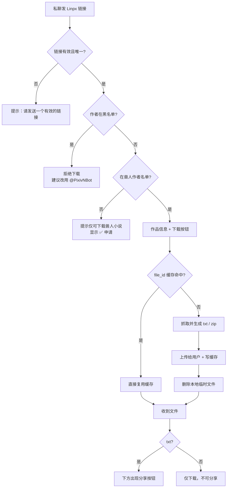

# 02 · 用户使用流程

> 面向：普通用户、内容分享者、频道管理员
> 代码基线：`44811fe`（2026-11-11）
> 按**当前实际行为**编写。标「当前限制」的地方是已知缺口，不是最终设计。
> 为什么这样设计看 [01](01-功能清单与缺口.md)，要改代码看 [04](04-如何改代码.md)。

---

## 0. 一分钟了解

1. 只面向**兽人向小说**，下载权限按**作者**判断，不按单篇。
2. 只支持 **Linpx / FurryNovel 链接**，不支持 Pixiv 原站链接。
3. 作者不在「兽人作者名单」里 → 不能下载，只能申请。
4. 作者在**黑名单** → 直接拒绝，不能下载，也不能申请。
5. 授权白名单（`white_authors.json`）暂不参与判定。
6. 分享的目标频道由 `SHARE_MODE` 决定：`test` 只发测试频道（`TEST_CHANNEL`）；`prod` 时高分作品发兽人阅读 + 兽人小说，低分 / 未评分只发兽人小说。
7. 上传后删除本地文件；`file_id` 缓存默认 7 天。

---

## 1. 能发什么

| 类型 | 示例 |
|---|---|
| 单篇 | `https://linpx.ink/pixiv/novel/18012577`　`https://linpx.ink/pn/18012577` |
| 系列 | `https://linpx.ink/pixiv/series/16181401` |
| 作者主页 | `https://linpx.ink/pixiv/user/130586197`　`https://linpx.ink/pu/130586197` |

- 必须在**私聊**里发；群聊里的普通文字不会被当作链接处理。
- 一次只能发**一个**链接。消息里 0 个或 2 个以上时，提示「请发送一个有效的小说、系列或作者链接。」

---

## 2. 主流程



---

## 3. 五个场景

### A · 下载单篇

| | |
|---|---|
| **怎么操作** | 发单篇链接 → 点「📄 下载本章 txt」 |
| **会看到** | 作品信息（标题 / 作者 / `#标签`）→ 提示「正在获取文件，请稍候……」→ `.txt` 文件 → 提示「还请去源网站，给作者一个收藏/评论」并约 2 秒后消失 → txt 下方出现分享按钮 |
| **注意** | 属于系列时会多出「📒 下载系列 txt」「📚 下载系列 zip」；7 天内重复下载走 `file_id` 缓存，明显更快；本地临时文件上传后删除，可能留空目录 |

### B · 下载系列

| | |
|---|---|
| **怎么操作** | 发系列链接 → 选「🤖 自动选择」/「📒 系列 txt」/「📚 系列 zip」 |
| **会看到** | 系列标题、作者、标签 → 逐章抓取（无进度条，章越多越慢）→ 一个 `.txt` 或 `.zip` |
| **自动选择规则** | 章节标题数字覆盖率 ≥ 75% → 视为连贯系列，合并成一个 txt；否则 → 按章拆成 txt 再打 zip |
| **注意** | txt 带分享按钮，zip 不带；若 txt 与 zip 都已缓存，会提示「该系列已有 txt 与 zip 缓存，请选择要下载的格式」；发单篇链接也能直接点「下载系列」 |

### C · 下载作者全部作品

| | |
|---|---|
| **怎么操作** | 发作者主页链接 → 点「👤 全部下载」 |
| **会看到** | 作者名、小说总数、系列总数、标签 → 一个以作者名命名的 `.zip`（系列按目录，无系列的单篇放「单篇」目录） |
| **注意** | 最慢的用法，逐章串行；**当前限制**：下载后作者目录可能残留在 `files/novels/`，需定期清理 |

### D · 申请未收录的作者

| | |
|---|---|
| **怎么操作** | 收到「仅可下载兽人小说」提示 → 点「✅ 申请」→ 阅读后果告知 → 点「✅ 确认」提交 |
| **会看到** | 申请卡片送进中转频道；管理员核验后私聊通知结果 |
| **申请前会明确告知** | 通过后该作者作品**可能被分享到频道**；作者事后可投诉下架 |
| **注意** | 同一作者已有待审申请时不会重复提交，只累计次数；核验仅中转频道管理员可操作 |

### E · 分享到频道

| | |
|---|---|
| **怎么操作** | 收到 txt 后，点「🉑 公开分享」/「㊙️ 私密分享」/「🈲 拒绝分享」 |
| **会看到** | 文件出现在频道；私聊回复「已经公开分享至 …」/「已经匿名分享至 …」 |
| **规则** | 只有 txt 能分享；同一作品默认 **3 天冷却**；并发点击会被拦截；分享时 `file_id` 缓存必须仍有效 |
| **当前限制** | ✅ 目标频道已按 `SHARE_MODE` 分流、文案按实际频道显示；历史分享的下架能力已就绪（记录带 `message_id`），但拉黑入口未接 |

常见失败提示：

| 提示 | 原因 | 怎么办 |
|---|---|---|
| 该作品正在分享中，请稍候再试 | 并发点击 | 等几秒 |
| 还剩 X 天可再次分享 | 冷却期内 | 等冷却 |
| 缓存已失效，请重新下载后再分享 | `file_id` 过期（默认 7 天） | 重新下载 |
| 未配置分享频道 | `TEST_CHANNEL` 为空 | 找管理员 |

---

### F · 作者本人申请下架

只有**作者主页链接**的菜单里才会出现「🈲 申请黑名单」，作品 / 系列链接不会。

| | |
|---|---|
| **怎么操作** | 私聊发自己的 Linpx 作者主页链接 → 点「🈲 申请黑名单」→ 点「✅ 确认」→ 按提示发送**截图** |
| **会收到** | ① 申请后果告知；② 受理后给材料清单（Pixiv 后台「作品管理 / 投稿一览」截图，**30 分钟内**有效）；③ 送审成功回执 |
| **规则** | 只接受作者本人；同一作者重复申请只累计次数；已在核验中的不会重复建单；已在黑名单的直接提示无需申请 |
| **核验** | 截图与申请一起进中转频道，管理员判断是否拉黑（通过 = 加入黑名单 + 移出兽人名单） |
| **注意** | 核验通过**不会删除已有的历史分享**（下架能力已就绪但暂不接线）；普通图片消息在没有待提交申请时会被静默忽略 |

常见失败提示：

| 提示 | 原因 | 怎么办 |
|---|---|---|
| 截图提交超时… | 超过 30 分钟才发图 | 重新发链接、重新点申请 |
| 材料已收到，但送审失败… | 未配置 `TRANSIT_CHANNEL` | 找管理员 |
| 该作者的下架申请已在核验中 | 重复申请 | 等通知 |

---

## 4. 管理员

### 4.1 审核申请

1. 打开中转频道（`TRANSIT_CHANNEL`，未配则回落到 `TEST_CHANNEL`）。
2. 找到 `#兽人作者申请` 卡片，核对作者主页是否确实为兽人向作者。
3. 点按钮（只有该频道的 `creator` / `administrator` 能点，无需维护 ID 名单）：

| 按钮 | 效果 |
|---|---|
| ✅ 通过 | 加入兽人作者名单，申请状态 `approved`，私聊通知申请人 |
| ❌ 拒绝 | 状态 `rejected`，不进任何名单，私聊通知申请人 |
| 🏡 主页 | 跳到作者 Linpx 主页，仅用于核对 |

4. 操作后卡片删除，频道留下 `#兽人作者申请_已完成` 回执。

> **当前限制**：只能修改频道权限来增删审核人；成员状态缓存 60 秒，撤销管理员后最多 1 分钟生效。
>
> **为什么没有「拉黑」按钮**：这里裁决的是「这位用户替作者提的申请是否成立」，不是「作者本人是否愿意被传播」。拉黑必须由作者本人的诉求触发，因此只留 通过 / 拒绝；下架历史分享的 `TakedownService` 已经写好，等「作者申请下架」流程落地后再接入口。

### 4.1.1 核验「作者申请下架」

中转频道里会出现另一种卡片：`#作者申请下架`，带作者主页链接、申请人和**后台截图**。

| 按钮 | 效果 |
|---|---|
| 🚫 拉黑 | 加入黑名单 + 移出兽人名单（`note=作者本人申请下架`），私聊通知申请人 |
| ❌ 拒绝 | 只把申请标记为 `rejected`，不进任何名单，私聊通知申请人 |
| 🏡 主页 | 跳到作者主页，用来核对截图里的账号 |

> 核验通过**不会删除历史分享**。要连带下架，需要另外接 `services/takedown_service.py`（能力已就绪）。

### 4.2 重推待审申请

发 `/review` → 扫描 `data/apply_authors.json` 里所有 `pending`，逐条重发到中转频道，回「✅ 已重新发送 X/Y 条」；没有待审则回「✅ 当前没有待审核申请」。

> **权限**：仅中转频道管理员可触发；身份按 Telegram 频道权限判断，无需配置 ID。

### 4.3 手工维护名单

直接编辑 JSON，Bot 通过文件 `mtime` 热加载，**无需重启**。

> ⚠️ 手工把作者写进 `black_authors.json` 会立刻阻止新的下载 / 分享，但**不会下架历史分享**：自动下架能力（`TakedownService`）还没有入口，等「作者申请下架」流程落地后再接。

```json
{
  "updated_at": "2026-11-11T00:00:00+0000",
  "authors": {
    "130586197": { "name": "吾寻", "note": "兽人作者申请通过" }
  }
}
```

| 文件 | 作用 |
|---|---|
| `data/furry_authors.json` | 兽人作者名单 → **决定能否下载** |
| `data/black_authors.json` | 黑名单 → 拒绝下载 |
| `data/white_authors.json` | 授权白名单 → **产品暂不接入判定，改了没用** |

### 4.4 检查清单

| 检查项 | 说明 |
|---|---|
| Bot 是否为频道管理员 | 否则无法发分享 / 中转消息 |
| `TEST_CHANNEL` 是否配置 | 分享的实际目标 |
| `TRANSIT_CHANNEL` 是否配置 | 未配置时回落到 `TEST_CHANNEL` |
| 中转频道是否私有 | 管理员判定已按频道权限，但仍建议私有 |
| `files/novels/` 是否定期清理 | 作者全量下载可能残留目录 |
| 黑名单是否需清理历史分享 | **无自动能力，只能手工删消息** |
| 定期备份 `data/*.json` | 无数据库，JSON 就是全部状态 |

---

## 5. FAQ

| 问题 | 回答 |
|---|---|
| 为什么发链接没反应？ | 确认是**私聊**、消息里只有**一个** URL、链接属于 Linpx / FurryNovel |
| 支持 Pixiv 原站链接吗？ | 不支持，请用 Linpx 链接 |
| 为什么提示「仅可下载兽人小说」？ | 作者不在兽人作者名单，可点「✅ 申请」等管理员核验 |
| 为什么下载按钮点不动？ | 消息过旧、文件仍在生成，或 Bot 出错。重发链接再试 |
| 为什么下载很慢？ | 系列 / 作者全量逐章抓取，且当前串行执行，没有进度条 |
| 为什么收到的 txt 没有分享按钮？ | 只有 txt 有；zip 不提供分享 |
| 为什么分享没出现在正式频道？ | 当前固定发到 `TEST_CHANNEL`，已知限制 |
| 为什么不能重复分享？ | 同一作品默认 3 天冷却 |
| 提示「缓存已失效」怎么办？ | 重新下载一次拿到新 `file_id` 再分享 |
| 申请后多久有结果？ | 人工审核，无固定时效；管理员可用 `/review` 重推 |
| 为什么没收到审核通知？ | 可能拉黑了 Bot，或私聊不可达，需主动联系管理员 |
| 文件会一直存在服务器上吗？ | 单篇 / 系列上传后删除；作者全量当前可能残留目录 |
| 能一次发多个链接吗？ | 不能，一次只处理一个 |
| 群聊里能发吗？ | 普通文字只处理私聊；`/down` 在 Bot 能收到命令的聊天里可用，但不建议群聊使用 |

---

## 6. 使用建议

**对用户**：优先用单篇 / 系列链接（作者全量最慢）；下载后去 Pixiv / Linpx 给作者收藏或评论；分享前确认作品允许公开传播；不要重复提交同一作者的申请（只会累加次数）；报错时把完整提示和链接发给管理员。

**对管理员**：中转频道务必设私有并尽快补权限校验；审核看作者主页的**整体创作方向**，不要只看单篇标签；拉黑前先确认是否要清理历史分享（当前需手工）；定期清 `files/novels/`、备份 `data/*.json`。

**这一版做不到的**：没有自动内容识别，没有翻译，没有作者自助拉黑，没有历史分享自动下架。

