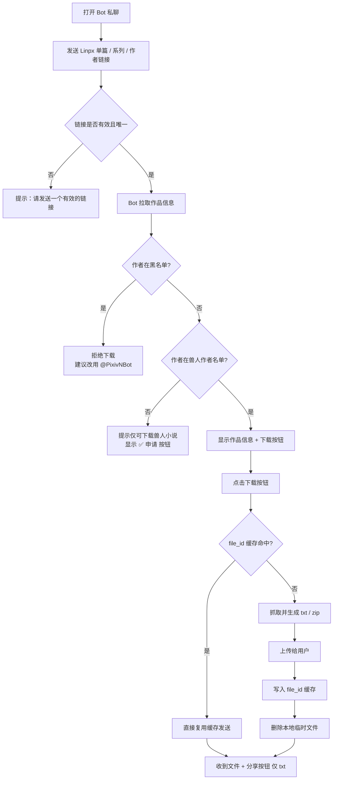
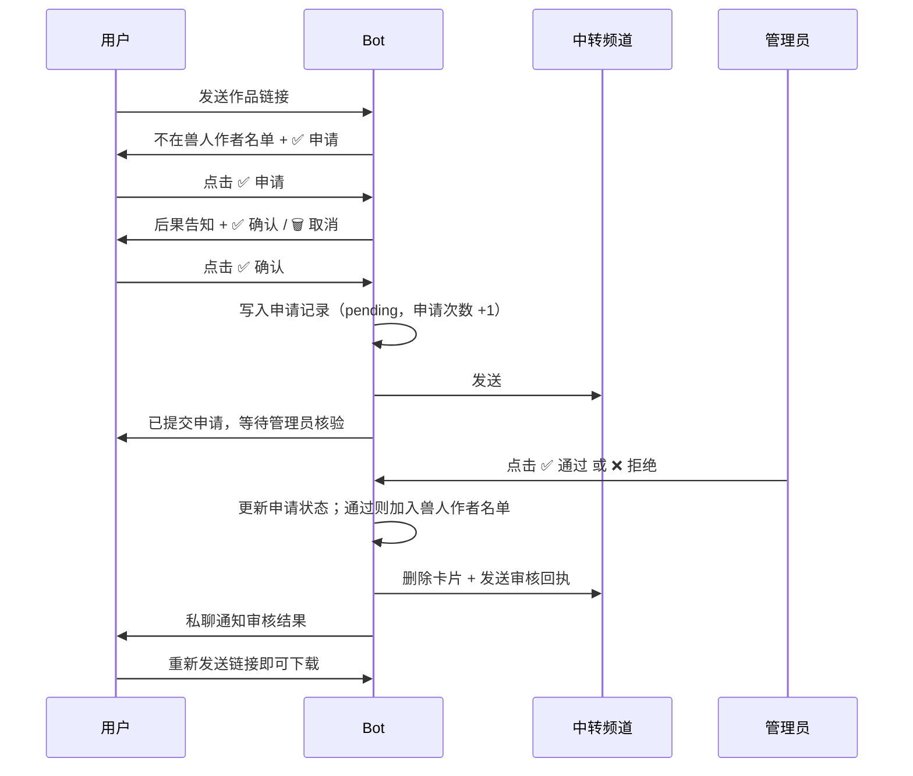
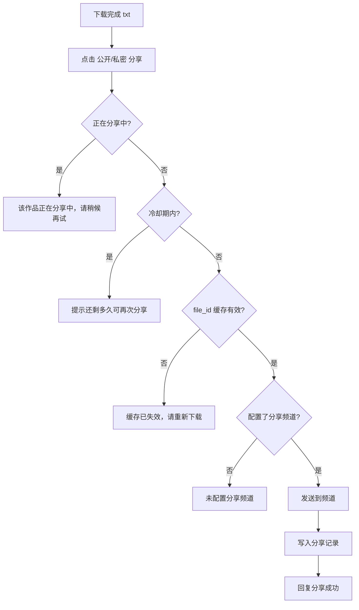
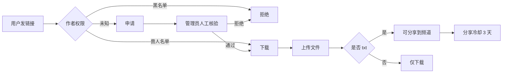

# 02 · 用户使用流程

> 适用对象：普通用户、内容分享者、频道管理员
> 对应代码：当前工作区（2026-11-11）
> 说明：本文按**当前实际行为**编写。文中标注「当前限制」的地方，是已知的产品缺口，不代表最终设计。

---

## 0. 使用前需要知道的事

1. 本 Bot 只面向 **兽人向小说**，下载权限按**作者**判断，不按单篇判断。
2. 当前只支持 **Linpx / FurryNovel 链接**，不支持 Pixiv 原站链接。
3. 作者必须已在「兽人作者名单」中才能下载；不在名单的作者需要先申请，由管理员人工核验。
4. 作者在黑名单中时，本 Bot 直接拒绝下载，建议改用公益下载 Bot `@PixivNBot`。
5. 下载完成后可以自愿分享到频道；**当前版本的分享实际发到测试频道**（见 7.4）。
6. 本地文件在上传后会被删除；Telegram `file_id` 缓存默认保留 7 天。

---

## 1. 准备工作

| 步骤 | 操作 | 说明 |
|---|---|---|
| 1 | 在 Telegram 搜索并打开 Bot | 例如 `@FurryReadingBot` |
| 2 | 点击「开始」或发送 `/start` | 当前欢迎语仍显示「这是一个空壳 Bot」，不影响使用 |
| 3 | 确认是**私聊**窗口 | 私聊里的普通文字才会被当作链接处理 |
| 4 | 准备一条 Linpx 链接 | 单篇 / 系列 / 作者主页都可以 |

支持的链接示例：

```text
https://linpx.ink/pixiv/novel/18012577
https://linpx.ink/pn/18012577
https://linpx.ink/pixiv/series/16181401
https://linpx.ink/pixiv/user/130586197
https://linpx.ink/pu/130586197
```

> 一次只能发**一个**链接。消息里有 0 个或 2 个以上链接时，Bot 会提示「请发送一个有效的小说、系列或作者链接。」

---

## 2. 最短路径



---

## 3. 场景 A：下载单篇

### 3.1 操作步骤

1. 私聊发送单篇链接，例如：
   `https://linpx.ink/pixiv/novel/18012577`
2. Bot 返回作品信息：
   - 标题
   - 作者
   - 标签（以 `#标签` 形式展示）
3. 如果这篇小说属于某个系列，底部会出现 3 个按钮：
   - 「📄 下载本章 txt」
   - 「📒 下载系列 txt」
   - 「📚 下载系列 zip」

   如果不属于系列，只显示「📄 下载本章 txt」。
4. 点击「📄 下载本章 txt」。
5. Bot 把原提示消息改成「正在获取文件，请稍候……」。
6. 稍等片刻，Bot 发来一个 `.txt` 文件；文件说明（caption）包含作品信息和链接。
7. 上传成功后，Bot 再把提示消息改为「还请去源网站，给作者一个收藏/评论，以表支持」，并在约 2 秒后删除该提示消息。
8. 如果这是 txt，文件消息下方会出现分享按钮：
   - 「🉑 公开分享」
   - 「㊙️ 私密分享」
   - 「🈲 拒绝分享」

### 3.2 当前行为说明

- 下载的是 `.txt` 纯文本，包含标题、作者、链接、标签、简介和正文。
- 同一篇作品 7 天内再次下载会直接复用 Telegram `file_id`，速度明显更快。
- 文件上传后本地临时文件会删除，但可能留下空目录（不影响使用）。

---

## 4. 场景 B：下载系列

### 4.1 操作步骤

1. 私聊发送系列链接，例如：
   `https://linpx.ink/pixiv/series/16181401`
2. Bot 返回系列标题、作者、标签，并显示 3 个按钮：
   - 「🤖 自动选择」
   - 「📒 下载系列 txt」
   - 「📚 下载系列 zip」
3. 选择一种：
   - **自动选择**：Bot 根据章节标题里的数字密度判断。
     - 数字覆盖率 ≥ 75% → 视为连贯系列，合并成一个 txt；
     - 否则 → 视为合集 / 短篇集，按章拆成 txt 后打 zip。
   - **下载系列 txt**：强制合并成一个 txt。
   - **下载系列 zip**：强制按章拆分后打包 zip。
4. 等待 Bot 逐章抓取。章节越多耗时越长，当前没有进度条。
5. 收到文件。
   - txt 会带分享按钮；
   - zip 不带分享按钮。

### 4.2 从单篇跳转系列

如果发送的是单篇链接，但该单篇属于某个系列，可以直接点「📒 下载系列 txt」或「📚 下载系列 zip」，无需再找系列链接。

### 4.3 两种缓存同时存在时

如果同一个系列的 txt 和 zip 都已被缓存过，「自动选择」会让用户二选一：

> 该系列已有 txt 与 zip 缓存，请选择要下载的格式

此时点「📒 下载系列 txt」或「📚 下载系列 zip」即可。

---

## 5. 场景 C：下载作者全部作品

1. 私聊发送作者主页链接，例如：
   `https://linpx.ink/pixiv/user/130586197`
2. Bot 返回作者信息：
   - 作者名
   - 小说总数、系列总数
   - 作者标签
3. 点击「👤 全部下载」。
4. Bot 会：
   1. 下载该作者的所有系列；
   2. 下载不属于任何系列的单篇，放在「单篇」目录；
   3. 把整个作者目录压缩成 zip。
5. 收到一个以作者名命名的 `.zip`。

注意事项：

- 这是最耗时的操作，作品多时可能需要较长时间。
- 当前没有进度提示，也没有并发下载。
- **当前版本作者全量下载后，服务器上的作者源目录可能残留**（已知问题），运营方需要定期清理 `files/novels/`。
- zip 不显示分享按钮；如需分享，请单独下载某篇 txt。

---

## 6. 场景 D：申请未收录的作者

### 6.1 什么时候需要申请

发送链接后，如果 Bot 回复：

> 不好意思，本 Bot 仅可下载兽人小说。
> 作者：XXX（#a123456）目前不在兽人小说作者名单
>
> 申请其为兽人小说作者？
>
> 如需下载其他 Pixiv 小说，可以使用 @PixivNBot

说明该作者尚未收录，需要先申请。

### 6.2 用户操作



### 6.3 申请前的告知内容

点击「✅ 申请」后，Bot 会明确告知：

1. 申请通过后，方可下载、分享该作者的小说；
2. 申请需要管理核验，申请期间不能下载、分享该作者的小说；
3. 作者事后可以投诉，届时将下架相关内容，并禁止下载、分享该作者的小说。

用户必须再点一次「✅ 确认」才会真的提交。

### 6.4 申请后的状态

| 情况 | Bot 回复 |
|---|---|
| 首次提交成功 | 「✅ 已提交兽人作者申请：作者名（#aID）管理员核验后会私聊通知结果」 |
| 已有待审申请 | 「作者 XXX（#aID）的申请已在审核中，请等待管理员核验」 |
| 作者已在兽人名单 | 「作者 XXX 已在兽人作者名单中，无需申请」 |
| 作者在黑名单 | 「作者 XXX 已被禁止通过本 Bot 下载与分享，无法申请加入兽人作者名单」 |

### 6.5 审核结果

- **通过**：Bot 私聊「✅ 你提交的兽人作者申请已通过」，并提示可以重新发送链接下载。
- **拒绝**：Bot 私聊「❌ 你提交的兽人作者申请未通过」，可联系管理员。
- 如果用户拉黑了 Bot，私聊通知会失败，但审核结果仍然会更新。
- 当前不会自动把作品发给用户，**需要用户重新发送一次链接**。

### 6.6 当前限制

- 如果运营方没有配置 `TRANSIT_CHANNEL`，申请虽然会写入记录，但管理员可能看不到；此时可以请管理员执行 `/review` 重推。
- 申请没有冷却时间，只记录申请次数。
- 审核按钮没有管理员权限校验（运营侧问题，普通用户不应接触中转频道）。

---

## 7. 场景 E：分享到频道

### 7.1 前提

- 刚下载完成的是 **txt** 文件；
- 文件缓存仍然有效（默认 7 天内）；
- 该作品在分享冷却期外（默认 3 天）。

zip 文件不显示分享按钮；缓存过期后需要重新下载。

### 7.2 三种分享方式

| 按钮 | 效果 | caption 署名 |
|---|---|---|
| 🉑 公开分享 | 分享到频道 | 「来自 {你的名字} 的分享」 |
| ㊙️ 私密分享 | 分享到频道 | 「来自 匿名用户 的分享」 |
| 🈲 拒绝分享 | 不分享 | 仅移除按钮 |

分享成功后 Bot 会回复：

- 公开：「已经公开分享至 {FURRY_READING}」
- 私密：「已经匿名分享至 {FURRY_READING}」

频道里的文件说明会额外附加：

> 喜欢还请去Pixiv收藏或评论，以支持作者 {FURRY_READING}

### 7.3 分享冷却

同一部作品（`kind:id`，例如 `novel:18012577`）默认 **3 天**内不能重复分享。冷却期内点击会提示：

> 该作品刚刚已经分享过，X 天 X 小时后可再次分享

txt 与 zip 共用同一个作品的冷却 key；由于目前只有 txt 能分享，实际影响不大。

### 7.4 当前限制（重要）

- **当前代码固定把文件发到 `TEST_CHANNEL`**。
- `FURRY_READING`、`FURRY_NOVELS`、`FURRY_READING_NEW_GROUP` 的发送列表在代码里被注释掉。
- 因此用户看到的「已经公开分享至 {FURRY_READING}」与实际目标频道可能不一致。
- 如果 `TEST_CHANNEL` 没有配置，会提示「未配置分享频道」。
- 如果缓存已过期，会提示「缓存已失效，请重新下载后再分享」。

### 7.5 分享流程图



---

## 8. 管理员流程

### 8.1 审核申请

1. 打开中转频道（`TRANSIT_CHANNEL`，未配置时是 `TEST_CHANNEL`）。
2. 找到 `#兽人作者申请` 卡片。
3. 核对作者主页是否确实为兽人向作者。
4. 点击按钮：
   - 「✅ 通过」：加入兽人作者名单，申请状态改为 `approved`，私聊通知申请人。
   - 「❌ 拒绝」：申请状态改为 `rejected`，不加入任何名单，私聊通知申请人。
   - 「🏡 主页」：跳转作者 Linpx 主页，仅用于核对。
5. 操作完成后，卡片会被删除，频道里会留下一条 `#兽人作者申请_已完成` 回执。

> 当前「🈲 拒绝并拉黑」按钮在 `keyboards.py` 中被注释，管理员无法从 UI 直接拉黑。

### 8.2 重推待审核申请

在中转频道或任意聊天执行：

```text
/review
```

Bot 会：

- 扫描 `data/apply_authors.json` 中所有 `pending` 记录；
- 逐条重新发送到中转频道；
- 回复「✅ 已重新发送 X/Y 条待审核申请到中转频道，请前往核验」。

如果没有待审核记录，会回复「✅ 当前没有待审核申请」。

> 当前 `/review` 没有管理员校验，建议只在私有频道使用，或尽快补权限。

### 8.3 手工维护名单

运营方可以直接编辑以下 JSON，Bot 通过文件 `mtime` 热加载，无需重启：

`data/furry_authors.json`

```json
{
  "updated_at": "2026-11-11T00:00:00+0000",
  "authors": {
    "130586197": {
      "name": "吾寻",
      "note": "兽人作者申请通过"
    }
  }
}
```

`data/black_authors.json` 结构相同。

`data/white_authors.json` 结构相同，但**当前业务不读取**，编辑不会改变下载权限。

### 8.4 管理员检查清单

| 检查项 | 说明 |
|---|---|
| Bot 是否为频道管理员 | 否则无法发送分享 / 中转消息 |
| `TRANSIT_CHANNEL` 是否配置 | 未配置会回退到 `TEST_CHANNEL` |
| `TEST_CHANNEL` 是否配置 | 当前分享的实际目标 |
| 中转频道是否私有 | 当前无权限校验，建议限制成员 |
| `files/novels/` 是否定期清理 | 作者全量下载可能残留目录 |
| 黑名单是否需要同步清理历史分享 | 当前没有自动删除能力，需要手工处理 |

---

## 9. 常见问题（FAQ）

| 问题 | 回答 |
|---|---|
| 为什么发链接没反应？ | 确认是**私聊**、消息里只有**一个** URL、链接属于 Linpx / FurryNovel。 |
| 支持 Pixiv 原站链接吗？ | 当前不支持，请使用 Linpx 链接。 |
| 为什么提示「仅可下载兽人小说」？ | 该作者不在兽人作者名单。可以点「✅ 申请」，等管理员核验。 |
| 为什么作者被拒绝？ | 作者可能在黑名单，或申请未通过。可联系管理员确认。 |
| 为什么下载按钮点不动？ | 可能是消息过旧、文件仍在生成，或 Bot 出错。重新发送链接再试。 |
| 为什么下载很慢？ | 系列 / 作者全量需要逐章抓取，且当前串行执行。 |
| 为什么收到的 txt 没有分享按钮？ | 只有 txt 有分享按钮；zip 不提供分享。 |
| 为什么分享没出现在正式频道？ | 当前版本固定发到 `TEST_CHANNEL`，属于已知限制。 |
| 为什么不能重复分享？ | 同一作品默认 3 天冷却。 |
| 提示「缓存已失效」怎么办？ | 重新下载一次，生成新的 `file_id` 后再分享。 |
| 申请后多久有结果？ | 人工审核，没有固定时效；管理员可用 `/review` 重推。 |
| 为什么没收到审核通知？ | 可能拉黑了 Bot，或 Telegram 私聊不可达；可主动联系管理员。 |
| 下载的文件会保存在服务器吗？ | 单篇 / 系列上传后会删除；作者全量当前可能残留目录。 |
| 可以批量发多个链接吗？ | 当前一次只处理一个链接。 |
| 群聊里发链接可以吗？ | 普通文字只处理私聊；`/down` 命令在 Bot 能收到命令的聊天里可用，但不建议在群聊使用。 |

---

## 10. 使用建议与注意事项

### 10.1 对普通用户

- 尽量使用单篇 / 系列链接，作者全量下载耗时最长。
- 下载后请去 Pixiv / Linpx 给作者收藏或评论。
- 分享前确认作品允许公开传播；作者可投诉下架。
- 不要重复提交同一个作者的申请，重复提交只会增加申请次数。
- 遇到错误提示，把完整提示和链接发给管理员，便于定位。

### 10.2 对管理员

- 中转频道务必设为私有，并尽快补管理员权限校验。
- 审核时优先看作者主页的整体创作方向，而不是单篇标签。
- 拉黑作者前，先确认是否需要清理历史分享（当前需手工）。
- 定期检查 `files/novels/` 占用，清理残留目录。
- 定期备份 `data/*.json`。
- 修改名单后不需要重启，但建议保持 JSON 格式合法。

### 10.3 当前流程的边界



**没有自动内容识别，没有翻译，没有作者自助拉黑，没有历史分享自动下架**——这些是后续版本要补的能力。
