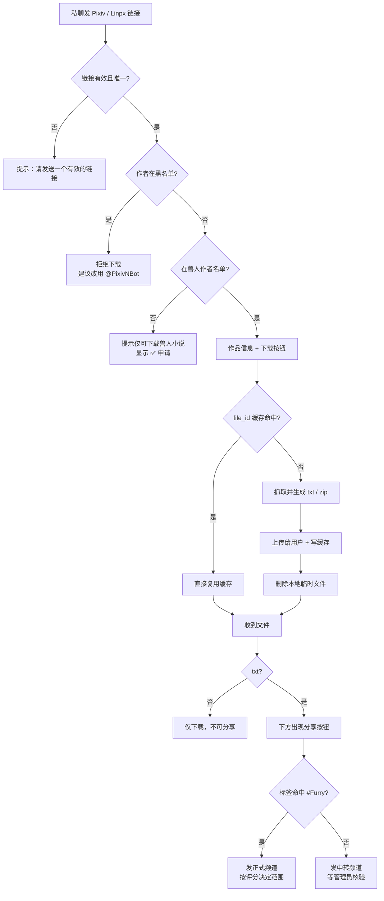

# 02 · 用户使用流程

> 面向：普通用户、内容分享者、频道管理员
> 代码基线：2026-11-23（历史改写后提交号会变，故只记日期）
> 按**当前实际行为**编写。标「当前限制」的地方是已知缺口，不是最终设计。
> 为什么这样设计看 [01](01-功能清单与缺口.md)，要改代码看 [04](04-如何改代码.md)。

---

## 0. 一分钟了解

1. 只面向**兽人向小说**，下载权限按**作者**判断，不按单篇。
2. 支持 **Linpx / FurryNovel 链接**，也支持 **Pixiv 原站链接**（作品 ID 是同一套，缓存 / 名单 / 分享记录互通）。
3. 作者不在「兽人作者名单」里 → 不能下载，只能申请。
4. 作者在**黑名单** → 直接拒绝，不能下载，也不能申请。
5. 分享的目标频道分两步：先按**作品标签**判断——命中 `#Furry` 才发正式频道（`SHARE_MODE=test` 只发测试频道；`prod` 时高分作品发兽人阅读 + 兽人小说，低分 / 未评分只发兽人小说），正式分享还会**同时发到配置的群组**；标签没命中 / 没有标签 → 只发**中转频道**，等管理员核验后人工放行；放行时按兽人小说分享（频道 + 群组）。
6. 上传后删除本地文件；`file_id` 缓存时长见 `config.py` 的 `FILE_CACHE_TTL_DAYS`。

---

## 1. 能发什么

| 类型 | Linpx 示例 | Pixiv 示例 |
|---|---|---|
| 单篇 | `https://linpx.ink/pixiv/novel/18012577`　`https://linpx.ink/pn/18012577` | `https://www.pixiv.net/novel/show.php?id=18012577` |
| 系列 | `https://linpx.ink/pixiv/series/16181401` | `https://www.pixiv.net/novel/series/16181401` |
| 作者主页 | `https://linpx.ink/pixiv/user/130586197`　`https://linpx.ink/pu/130586197` | `https://www.pixiv.net/users/130586197` |

- 必须在**私聊**里发；群聊里的普通文字不会被当作链接处理。
- 一次只能发**一个**链接。消息里 0 个或 2 个以上时，提示「请发送一个有效的小说、系列或作者链接。」
- Pixiv 原站的 **R18 作品需要管理员配置 `PIXIV_COOKIE`**（见 [07 §4](07-配置与部署.md)）；该变量属于**启动必填项**，没配时 Bot 无法启动，不会只在 R18 时才提示。登录态失效时会收到「该作品是 R18，需要配置 PIXIV_COOKIE 才能读取正文」，不会给出空文件。

---

## 2. 主流程

---

## 3. 六个场景

### A · 下载单篇

| | |
|---|---|
| **怎么操作** | 发单篇链接 → 点「📄 下载本章」 |
| **会看到** | 作品信息 → 「正在获取文件」→ `.txt` → 求收藏提示 → 分享按钮 |
| **注意** | 属系列时多出系列按钮；缓存期内走 `file_id`；上传后删工作目录 |

### B · 下载系列

| | |
|---|---|
| **怎么操作** | 发系列链接 → 选「🤖 自动选择」/「📒 txt」/「📚 zip」；可先点「📄 下载首章」 |
| **会看到** | 系列标题、作者、标签 → 逐章抓取 → 一个 `.txt` 或 `.zip` |
| **自动选择** | 章节标题数字覆盖率 ≥ 75% → 合并 txt；否则分包 zip |
| **注意** | 系列卡片 3 + 3 六个按钮；txt 带分享按钮，zip 不带；txt / zip 都已缓存时只出 5 个按钮的格式选择卡片 |

### C · 下载作者全部作品

| | |
|---|---|
| **怎么操作** | 发作者主页链接 → 点「👤 全部下载」 |
| **会看到** | 作者名、小说总数、系列总数、标签 → 一个以作者名命名的 `.zip`（系列按目录，无系列的单篇放「单篇」目录） |
| **注意** | 最慢的用法：系列逐个拉取，章节限并发（4）拉取 |

### D · 申请未收录的作者

| | |
|---|---|
| **怎么操作** | 点「✅ 申请兽人作者」→ 读后果告知 → 确认；也可发 `/furry 10809330` |
| **会看到** | 申请卡片送进中转频道；管理员核验后私聊通知 |
| **申请前会告知** | 通过后作品可能被分享；作者事后可投诉下架 |
| **注意** | 已有待审申请时只累计次数；同一作者 1 天 1 次（`APPLY_COOLDOWN_HOURS`） |

### E · 分享到频道

| | |
|---|---|
| **怎么操作** | 收到 txt 后点「🉑 公开分享」/「㊙️ 私密分享」/「🈲 拒绝分享」 |
| **会看到** | 文件出现在频道；私聊回执 |
| **规则** | 仅 txt；有分享冷却；缓存需有效；作者被拉黑则拒绝 |
| **群组** | 正式分享同时发群组（未配置跳过） |

- 同一作品分享冷却见 `SHARE_COOLDOWN_DAYS`；并发点击会被拦截。
- 群组收到同样的文件与 caption，回执只列频道。
- 作者下架核验通过（`rby`）时，频道与群组的历史消息都会删除。

常见失败提示：

| 提示 | 原因 | 怎么办 |
|---|---|---|
| 该作品正在分享中，请稍候再试 | 并发点击 | 等几秒 |
| 还剩 X 天可再次分享 | 冷却期内 | 等冷却 |
| 缓存已失效，请重新下载后再分享 | `file_id` 过期（`FILE_CACHE_TTL_DAYS`） | 重新下载 |
| 未配置分享频道 | 当前模式需要的频道为空（`test` → `TEST_CHANNEL`，`prod` → `FURRY_NOVELS`） | 找管理员 |

---

### F · 作者本人申请下架

只有**作者**相关的入口才会出现「🈲 申请下架」：① 未收录作者时的申请键盘（单篇 / 系列 / 作者链接都可能出现）；② 兽人作者的作者页键盘。也可以直接发 `/black`：不带参数回用法提示，带作者 ID 或作者主页链接时直接给出确认键盘。

| | |
|---|---|
| **怎么操作** | 作者主页 → 「🈲 申请下架」→ 确认 → 发截图；也可 `/black 作者ID` |
| **会收到** | 后果告知 → 材料清单（`BLACK_REQUEST_MATERIAL_TTL_MINUTES` 内有效）→ 送审回执 |
| **规则** | 仅作者本人；同一作者 1 天 1 次；同一时间只允许一个受理 |
| **核验** | 管理员通过 = 拉黑 + 移出兽人名单 + 删历史分享 |
| **注意** | 截图可发图片或「文件」形式的图片；无待交材料时其他图片静默忽略 |

- 同一用户同时只保留一条待交材料；已在核验中的不会重复建单；已在黑名单会提示无需申请。
- 冷却从「提交截图送审」算起，只受理不交截图（过期作废）不占冷却。

常见失败提示：

| 提示 | 原因 | 怎么办 |
|---|---|---|
| 截图提交超时… | 超过时限才发图（`BLACK_REQUEST_MATERIAL_TTL_MINUTES`，只提示一次，申请随即作废） | 重新发链接、重新点申请 |
| 你之前的申请等待截图超时，已被新的申请接替… | 自己的受理过期后有人重新受理，那条记录被接手（`previous_user_id`） | 重新发链接、重新点申请 |
| 材料已收到，但送审失败… | 未配置 `TRANSIT_CHANNEL` | 找管理员 |
| 该作者的下架申请已在核验中 | 重复申请（本人） | 等通知 |
| 该作者的申请已由其他用户发起… | 同一作者只允许同一用户受理：别人正在交截图 / 核验中 | 等对方交材料或管理员核验；材料窗口（30 分钟）作废后可再试 |
| 你还有作者 X 的截图没交 | 同一用户同时只留一条待交材料 | 先把那张截图发出来，或等窗口过期再来申请 |
| 同一作者 1 天内只能申请一次 | 冷却期内（`APPLY_COOLDOWN_HOURS`，按送审算） | 等冷却结束再申请 |

---

## 4. 管理员

> `/help` 会按身份裁剪：普通用户只看得到公开命令，中转频道管理员会多出一段管理命令（`/sync` `/review` `/furryadd` 等）。身份判定为默认拒绝，查不到频道成员状态时按普通用户处理。

### 4.1 审核申请

1. 打开中转频道（`TRANSIT_CHANNEL`，未配则回落到 `TEST_CHANNEL`）。
2. 找到 `🐺 #兽人作者申请` 卡片，核对作者主页是否确实为兽人向作者。
3. 点按钮（只有该频道的 `creator` / `administrator` 能点，无需维护 ID 名单）：

| 按钮 | 效果 |
|---|---|
| ✅ 通过 | 加入兽人作者名单，私聊通知申请人 |
| ❌ 拒绝 | 不进任何名单，私聊通知申请人 |
| 🏡 主页 | 跳到作者 Linpx 主页，仅用于核对 |

4. 操作后卡片删除，频道留下 `🐺 #兽人作者申请已通过`（或 `🐺 #兽人作者申请已拒绝`）回执。

> **当前限制**：只能修改频道权限来增删审核人；成员状态缓存 60 秒，撤销管理员后最多 1 分钟生效。
>
> **为什么没有「拉黑」按钮**：这里裁决的是「这位用户替作者提的申请是否成立」，不是「作者本人是否愿意被传播」。拉黑必须由作者本人的诉求触发，因此只留 通过 / 拒绝；下架历史分享挂在「作者下架申请」的核验入口（`rby`）上。

### 4.1.1 核验「作者下架申请」

中转频道里会出现另一种卡片：`🈲 #作者下架申请`，带作者主页链接、申请人和**后台截图**。

| 按钮 | 效果 |
|---|---|
| 🈲 下架 | 拉黑 + 移出兽人名单 + 删历史分享，私聊通知申请人 |
| ❌ 拒绝 | 不进任何名单，也不动历史分享，私聊通知申请人 |
| 🏡 主页 | 跳到作者主页，用来核对截图里的账号 |

> 核验通过后**会同时下架频道里的历史分享**（`services/takedown_service.py`）：删除成功的记录清掉；删除失败的保留 `chat_id` / `message_id`，下次还能拿到；没有消息句柄的老记录计入 `skipped`，需要手工处理。

### 4.1.2 核验「待确认的兽人小说」

标签没命中 `#Furry` 的分享会带着「⚠️ 待核验」caption 和文件进中转频道，卡片下方有两个按钮（仅中转频道管理员可点）：

| 按钮 | 效果 |
|---|---|
| 🉑 允许分享 | 用缓存 `file_id` 发 `FURRY_NOVELS` + 群组，挂阅读键盘，删中转卡片 |
| 🈲 禁止分享 | 不发布，直接删掉中转卡片 |

> 放行前会按当前名单复查作者（已被拉黑 / 不在兽人名单 → 不转发）；缓存过期（`FILE_CACHE_TTL_DAYS`）也无法放行，需要分享者重新下载后再分享。
>
> 放行后正式频道 / 群组那条消息会写进分享记录（带 `message_id`），作者日后下架时能一并删除；中转卡片那条记录会被摘掉，避免下架时去删一条已经删掉的消息。群组发送失败不影响频道放行，回执会补一句「部分目标发送失败」。

### 4.2 重推待审申请

发 `/review` → 扫描所有待审申请（兽人作者待审 + 作者下架待核验），逐条重发到中转频道，回「✅ 已重新发送 X/Y 条待审核申请到中转频道（兽人作者 a，作者下架 b），请前往核验」；没有待审则回「✅ 当前没有待审核的申请」。

> **权限**：仅中转频道管理员可触发；身份按 Telegram 频道权限判断，无需配置 ID。

### 4.3 直接改名单（`/furryadd`、`/blackadd`、`/furryremove`、`/blackremove`）

管理员可以跳过「申请 → 核验」，一条命令改名单：

| 命令 | 效果 |
|---|---|
| `/furryadd 作者ID或链接` | 加入兽人作者名单；已在黑名单的作者拒绝写入 |
| `/blackadd 作者ID或链接` | 拉黑 + 移出兽人名单 + 下架历史分享 |
| `/furryremove 作者ID或链接` | 移出兽人作者名单；不拉黑、不删历史分享 |
| `/blackremove 作者ID或链接` | 解除拉黑；先重试删除历史分享，仍有失败就拒绝解除 |

- **权限**：与 `/review` 一样按中转频道 `creator` / `administrator` 判断；非管理员只收到一句拒绝。
- **不做前置**：不要截图、不二次确认、不写申请记录，因此也不占 1 天冷却。
- **结果留在中转频道**：回执复用核验文案，末尾加 `🛡 管理员直接添加` / `🛡 管理员直接拉黑`（移除类为 `🛡 管理员直接移除` / `🛡 管理员解除拉黑`）；下架有失败时回执挂「🔁 重试删除」。
- 作者已在名单里 → 回「已在…中，未重复写入」；作者名抓不到也会写入，只是名单里暂时只有 ID。
- `/blackremove` 依赖作者仍在黑名单才能重试删除，所以先跑一遍删除，还有失败就不解除。

> 名单只通过命令修改，不提供手工编辑入口。`/blackadd` 与核验通过等价，**会删掉频道里的历史分享**。

### 4.4 检查清单

> 频道 ID、分享模式、部署方式的完整配置说明见 [07 §4~§5](07-配置与部署.md)。

| 检查项 | 说明 |
|---|---|
| Bot 是否为频道管理员 | 否则无法发分享 / 中转消息 |
| `SHARE_MODE` 与对应频道 | `test` 需要 `TEST_CHANNEL`；`prod` 需要 `FURRY_NOVELS`，评分达标还要 `FURRY_READING` |
| `TRANSIT_CHANNEL` 是否配置 | 未配置时回落到 `TEST_CHANNEL` |
| 中转频道是否私有 | 管理员判定已按频道权限，但仍建议私有 |
| 历史分享清理 | 核验通过（`rby`）与 `/blackadd` 会自动删 |
| 定期备份 | `data/` 就是全部状态 |

---

## 5. FAQ

| 问题 | 回答 |
|---|---|
| 为什么发链接没反应？ | 确认是**私聊**、消息里只有**一个** URL、链接属于 Linpx / FurryNovel |
| 支持 Pixiv 原站链接吗？ | 支持，单篇 / 系列 / 作者主页都可以；R18 需要部署方配置 `PIXIV_COOKIE`（启动必填） |
| 为什么提示「仅可下载兽人小说」？ | 作者不在兽人作者名单，可点「✅ 申请兽人作者」等管理员核验 |
| 为什么下载按钮点不动？ | 消息过旧、文件仍在生成，或 Bot 出错。重发链接再试 |
| 为什么下载很慢？ | 系列 / 作者全量逐章抓取（章节限并发 4），没有进度条 |
| 为什么收到的 txt 没有分享按钮？ | 只有 txt 有；zip 不提供分享 |
| 为什么分享没出现在正式频道？ | 看 `SHARE_MODE`：`test` 只发测试频道；`prod` 先发 `FURRY_NOVELS`，评分达标再发 `FURRY_READING` |
| 为什么不能重复分享？ | 同一作品有分享冷却（`SHARE_COOLDOWN_DAYS`） |
| 提示「缓存已失效」怎么办？ | 重新下载一次拿到新 `file_id` 再分享 |
| 申请后多久有结果？ | 人工审核，无固定时效；管理员可用 `/review` 重推 |
| 为什么提示「同一作者 1 天内只能申请一次」？ | 申请有 1 天冷却（`APPLY_COOLDOWN_HOURS`），兽人作者申请从「提交申请」算、下架申请从「提交截图送审」算；冷却结束后可以再申请 |
| 为什么没收到审核通知？ | 可能拉黑了 Bot，或私聊不可达，需主动联系管理员 |
| 文件会一直存在服务器上吗？ | 不会。每次下载都在 `files/work/` 下用独立目录打包，上传后连同目录一起删除 |
| `/sync` 是做什么的？ | 抓 Linpx 推荐作者并入名单，再把运营数据提交到私有仓库；仅管理员可触发（Linux `.sh` / Windows `.ps1`） |
| 能一次发多个链接吗？ | 不能，一次只处理一个 |
| 群聊里能发吗？ | 普通文字只处理私聊；`/down` 在 Bot 能收到命令的聊天里可用，但不建议群聊使用 |

---

## 6. 使用建议

**对用户**：优先用单篇 / 系列链接（作者全量最慢）；下载后去 Pixiv / Linpx 给作者收藏或评论；分享前确认作品允许公开传播；不要重复提交同一作者的申请（只会累加次数）；报错时把完整提示和链接发给管理员。

**对管理员**：中转频道务必设私有（管理员判定已按该频道的 `creator` / `administrator` 权限，撤销后最多 60 秒生效）；审核看作者主页的**整体创作方向**，不要只看单篇标签；核验通过或 `/blackadd` 会自动删除频道里的历史分享；定期备份 `data/`。

**这一版做不到的**：没有自动内容识别，没有翻译，没有作者自助立即拉黑（作者可发起下架申请，但仍需管理员核验）。

