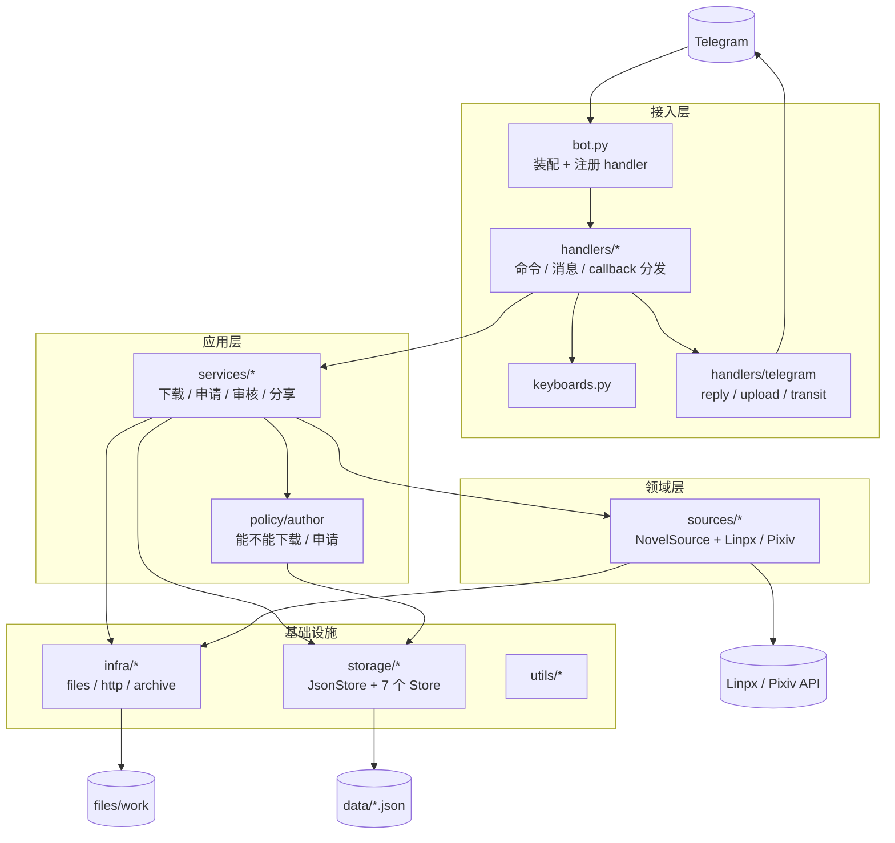

# 03 · 项目架构说明

> 代码基线：2026-11-23（历史改写后提交号会变，故只记日期）
> 本文回答「系统由哪些部分构成、边界在哪、哪里不好」。
> **调用链怎么走、改代码改哪一层 → 看 [04](04-如何改代码.md)；功能有没有 → 看 [01](01-功能清单与缺口.md)；时序图 → 看 [05](05-运行时序.md)；往哪走 → 看 [06](06-未来架构.md)；怎么装 / 怎么配 / 怎么跑 → 看 [07](07-配置与部署.md)；标签词表怎么写 → 看 [08](08-标签词表.md)。**

---

## 0. 一句话

**单体、事件驱动、分四层的 Telegram Bot**：

```text
handlers（接入） → services（用例编排） → sources（领域模型） → storage / infra（基础设施）
```

一个 Python 进程 + 一组 JSON 文件即可运行。没有任务队列、没有 Web 服务。

**三条红线**（自查命令见 §1）：

- `services/` 及以下**不 import telegram**：上传、删除、送审都通过回调注入；
- **只有 `storage/` 读写业务 JSON**：原子写 + mtime 热加载 + 进程内锁；
- 新增来源 = 实现 `NovelSource` + 在 `sources/__init__.py` 的 `_SOURCES` 注册一行。

---

## 1. 分层与依赖



### 依赖规则（可自查）

| 层 | 可以依赖 | **绝对不可以** |
|---|---|---|
| `handlers/` | telegram、services、policy、storage、sources、keyboards | — |
| `services/` | policy、sources、storage、infra、utils | **telegram** |
| `policy/` | storage（只读名单）、utils | services、telegram |
| `sources/` | infra、utils | services、telegram |
| `storage/` | infra、utils | services、telegram |
| `infra/` `utils/` | 彼此 | 任何上层 |

实测（2026-11-23）：`telegram` 只被 `handlers/` 下 **17 个文件** import，其余目录 0 处。自查命令见 **04 第 2.2 节**。

**依赖方向实测已干净**：`sources/` 不再 import `infra.files` / `infra.archive`，落盘、命名、压缩都下沉到 `services/packaging.py`，领域层可以脱离文件系统测试。

### 设计原则（代码里真实成立的）

| 原则 | 体现 |
|---|---|
| 单一入口 | 所有 Update 从 `bot.py` 进 |
| 回调集中路由 | `callbacks/router.py` 用字典分发 action |
| 用例收口 | 下载 / 申请 / 审核 / 分享都在 `services/` |
| 名单判定收口 | `policy/author.py` 一份规则，下载与申请共用 |
| 管理员判定收口 | `policy/admin.py` 按中转频道权限判定，不维护 ID 名单 |
| 来源适配 | `NovelSource` 抽象 + `_SOURCES` 注册表 |
| 文件即状态 | JSON + mtime 热加载，零外部依赖 |
| 即传即删 | 上传后 `remove_file` |
| 缓存优先 | `file_id` 缓存 + 分享冷却 |

---

## 2. 目录与职责

### 2.1 目录树

```text
FurryReadingBot/
├─ bot.py                  # 入口：装配 Application，注册 13 个命令 / 2 个消息 / 1 个 callback
├─ config.py               # 从 .env 读配置（频道、分享模式、冷却、缓存 TTL）
├─ keyboards.py            # 全部 InlineKeyboardMarkup（纯展示）
├─ handlers/               # 接入层：命令、私聊消息、图片
│  ├─ start.py             #   /start /help /ping /sponsor
│  ├─ author.py            #   /black /furry 申请 + 4 个管理员名单命令
│  ├─ download.py          #   /down 与私聊链接：解析 → 权限 → 出下载菜单
│  ├─ review.py            #   /review 重推待审申请
│  ├─ sync.py              #   /sync 同步运营数据到私有仓库
│  ├─ media.py             #   私聊截图：作者下架材料
│  ├─ callbacks/           #   callback_data 分发与各业务展示（router + 6 个业务模块）
│  └─ telegram/            #   Telegram 适配：reply / upload / transit / membership / takedown
├─ services/               # 应用层：用例编排，不 import telegram
├─ policy/                 # 规则层：只回答「能不能」，不读写业务数据
├─ sources/                # 领域层：来源适配（linpx / pixiv 均已接入）
├─ storage/                # 存储层：全仓唯一读写 JSON 的地方
├─ infra/                  # 基础设施：http（aiohttp 会话复用）/ files / archive（pyzipper AES）
├─ utils/                  # 通用工具：json（JsonDict）/ links / time / timer
├─ data/                   # 运行数据（JSON + tags.toml；不放脚本）
├─ data.example/           # 数据模板（含一份公开兽人作者名单 + 空记录 + tags.toml 词表样例）
├─ files/work/             # 下载打包目录（gitignore，每次下载独立子目录，交付后删除）
├─ deploy/                 # 部署：bot unit + 数据同步 service / timer（路径按实际部署改）
├─ script/                 # 运维脚本：sync_data.{sh,ps1}（把 data/ 提交到私有仓库）
├─ docs/                   # 01~08 设计 / 流程 / 改代码 / 部署 / 标签词表文档
└─ test/                   # pytest 用例（词表由 test/conftest.py 固定为样例词表）
```

> 安装、配置、启动、部署的完整步骤见 [07 §1~§8](07-配置与部署.md)，本文只讲「每块代码负责什么」。

### 2.2 逐项职责

| 路径 | 职责 |
|---|---|
| `bot.py` | 装配 `Application`，注册 13 命令 + 2 消息 + 1 callback |
| `config.py` | 读 `.env` 与代码常量；`config_errors()` 启动校验 |
| `keyboards.py` | 全部 `InlineKeyboardMarkup`（13 个都在用） |
| `handlers/start.py` | `/start` `/help` `/ping` `/sponsor` |
| `handlers/author.py` | `/black` `/furry` + 4 个管理员名单命令 |
| `handlers/download.py` | `/down` 与私聊链接：解析 → 权限 → 菜单 |
| `handlers/review.py` | `/review` 重推待审 |
| `handlers/sync.py` | `/sync` 推荐作者 + 运营数据同步 |
| `handlers/callbacks/router.py` | 按 action 分发到 6 个 callback 模块 |
| `handlers/callbacks/{download,apply,author,review,blacklist,share}.py` | 各业务的 Telegram 展示逻辑 |
| `handlers/telegram/reply.py` | 统一回复（默认 3 秒后删消息） |
| `handlers/telegram/upload.py` | `send_document`（本地文件或 `file_id`） |
| `handlers/telegram/transit.py` | 中转频道卡片 + 审核键盘 |
| `handlers/telegram/membership.py` | 查中转频道成员状态（60 秒缓存） |
| `handlers/telegram/takedown.py` | 删除频道消息（「已不存在」算成功） |
| `services/download_service.py` | 检查 / 权限 / 缓存 / 抓取 / 上传编排 |
| `services/packaging.py` | 落盘 / 命名 / 压缩；独立工作目录，章节限并发 4 |
| `services/apply_service.py` | 名单校验 / 重复待审 / 写记录 / 送审 |
| `services/review_service.py` | 审核状态 + 名单 + 幂等回滚 |
| `services/share_service.py` | 冷却 / 缓存 / 标签分流 / 频道 + 群组 / 记录 |
| `handlers/callbacks/share.py` | 分享按钮 + 中转放行 / 不通过 |
| `services/takedown_service.py` | 按作者删除历史分享，失败保留记录 |
| `services/sync_service.py` | 执行同步脚本、超时与输出收集 |
| `services/import_author_service.py` | 抓 Linpx 推荐作者并入名单 |
| `services/tag_service.py` | 标签留档装配 + 运营读写 |
| `services/blacklist_service.py` | 受理 / 材料提交 / 核验；受理互斥 |
| `handlers/callbacks/blacklist.py` | `ab` / `aby` / `rby` / `rbn` |
| `handlers/media.py` | 私聊图片 → 下架材料 |
| `policy/author.py` | 黑名单 / 兽人名单判定 |
| `policy/admin.py` | 中转频道管理员判定（默认拒绝） |
| `policy/scoring.py` | 推荐指数计算 |
| `sources/base.py` | `Novel` / `Series` / `Author` / `NovelSource` |
| `sources/__init__.py` | `_SOURCES` + `fetch` / `resolve_link` / `resolve_source` |
| `sources/errors.py` | 来源错误基类 `SourceError` |
| `sources/linpx/` `sources/pixiv/` | 两家来源：client / parse / urls |
| `sources/utils.py` | 系列合并判断（覆盖率 ≥ 75%） |
| `sources/tags.py` | 词表加载 / 校验 / 规范化 |
| `storage/*` | 唯一读写业务 JSON 的层（原子写 + 热加载） |
| `infra/*` | 文件 / HTTP / 压缩 |
| `utils/*` | `JsonDict` / 链接 / 时间 / 计时 |
| `data/tags.toml` | 标签词表（见 [08](08-标签词表.md)） |
| `script/` | 同步脚本（`/sync` 与定时任务共用） |
| `test/*.py` | pytest 用例 |

几条关键约束：

- 下层（`services/` / `policy/` / `sources/` / `storage/`）不 import telegram；上传、删除、送审都靠回调注入。
- 只有 `storage/` 读写 `data/*.json`：原子写 + mtime 热加载 + 进程内锁；TTL / 冷却统一从 `config.py` 取。
- `sources/` 只返回模型，落盘与压缩在 `services/packaging.py`。
- 新增来源 = 实现 `NovelSource` + 在 `_SOURCES` 注册一行。

---

## 3. 外部 API

| 来源 | 用途 | 地址 |
|---|---|---|
| Linpx | 展示链接 | `https://linpx.ink/pixiv/novel/{id}` |
| Linpx | 单篇正文 | `https://api.linpx.ink/pixiv/novel/{id}/cache` |
| Linpx | 系列与章节 | `https://api.linpx.ink/pixiv/series/{id}/cache` |
| Linpx | 作者作品列表 | `https://api.linpx.ink/pixiv/user/{id}/cache` |
| Linpx | 推荐作者（`/sync` 合并名单用） | `https://api.linpx.ink/fav/user/cache` |
| Pixiv | 单篇详情 / 正文 | `https://www.pixiv.net/ajax/novel/{id}` |
| Pixiv | 系列元信息 | `https://www.pixiv.net/ajax/novel/series/{id}` |
| Pixiv | 系列章节 ID + 标题 | `https://www.pixiv.net/ajax/novel/series/{id}/content_titles` |
| Pixiv | 作者资料 | `https://www.pixiv.net/ajax/user/{id}?full=1` |
| Pixiv | 作者全部作品 | `https://www.pixiv.net/ajax/user/{id}/profile/all` |

- Linpx 请求都带 `Referer: https://linpx.ink/`；
- Pixiv 请求带 `Referer` / 浏览器 UA；账号池随机起始、单号连续 100 次轮换，单号 0.5s / 全局 0.3s 间隔 + 抖动，429 单号冷却 15 分钟，401/403 故障转移。`PIXIV_COOKIE` 是启动必填（推荐裸 `PHPSESSID`，多账号用换行或 `||` 分隔）；登录态失效时 R18 内容会明确报登录错误。
- 两家共用同一套 Pixiv 作品 / 作者 ID，所以 `file_id` 缓存、作者名单、分享记录可以互通。
- Pixiv 正文里的标记（`[newpage]` / `[chapter:]` / `[pixivimage:]` / `[uploadedimage:]` / `[[rb:]]` / `[[jumpuri:]]` / `[b:]` / `[i:]` / `[jump:]`）**暂未清洗**：`sources/format.py · format_pixiv_content()` 保留但 `sources/pixiv/parse.py` 原样返回 `content`，标记会原样进 txt（3 条用例被 `@skip_cleaning` 跳过）；`content_titles` 里 `available=false` 的章节仍然跳过。

---

## 4. 架构上的优点

1. **用例已收口到 `services/`**。六条链路（下载 / 申请 / 审核 / 分享 / 下架申请 / 历史下架）都能脱离 Telegram 单测，这是 614 个测试能跑起来的前提。
2. **来源适配有扩展点**。`NovelSource` + `_SOURCES` 注册表，加新来源只需实现接口 + 注册一行。
3. **存储轻到极致**。`JsonStore` 统一了原子写、热加载、锁、prune 与默认值解析，7 个 Store 各自只写几十行；申请类公共部分收在 `AuthorRequestStore`，过期判定只剩 `utils/time` 的三处实现。
4. **`storage/` 是唯一的业务持久化层**。业务 JSON 只有它读写，`policy` / `services` 只调 `is_blacklisted()` / `get_valid()` / `set_status()` 这类语义方法；默认名单实例收口在 `storage.get_lists()`，策略 / 申请 / 下载 / 审核四处共用同一份。（`infra/files.py` 的 `read_json()` / `save_json()` 只给脚本与测试写临时文件，不碰 `data/*.json`。）
5. **缓存策略有效**。`file_id` 复用 + 分享冷却，显著减少重复上传和刷屏。

---

## 5. 架构上的问题

| 级别 | 问题 | 影响 |
|---|---|---|
| P0 | `callback_data` 无签名 | 可伪造 action；敏感按钮已加管理员校验 |
| P1 | 名单互不清 | `add_blacklist` 不清兽人名单（下架流程显式移出） |
| P1 | 跨文件无事务 | 状态与名单分开写，靠回滚兜底 |
| P1 | 无任务队列、无进度 | 长下载占住 Update 链路 |
| P2 | JSON 全量重写 + 进程内锁 | 只适合单实例，多实例会互相覆盖 |
| P2 | 无 lint / format / type | 只有 Tab 缩进守门 |
| P2 | 无 Dockerfile / 健康检查 / 指标 | 部署与观测受限 |

---

## 6. 演进建议

### 三阶段

1. **修 P0**：`callback_data` 无签名（敏感按钮已加管理员校验）。
2. **抽 `policy/`、修正依赖方向**：已完成。
3. **按数据量决定**是否上任务队列——现在还为时过早。

### 目标形态

`policy/` 的完整目录树、每条规则的当前落点、实施顺序，都在 **[06 · 未来架构](06-未来架构.md)**。

一句话：**`policy` 回答「能不能」，`storage` 回答「存在哪」，`services` 回答「按什么顺序做」。**

### 迁移步骤（剩余）

| 步骤 | 动作 | 状态 |
|---|---|---|
| 1 | 分享频道改为可配置列表 | ⚠️ 目前仍是固定 env |
| 2 | 审核单事务 / 幂等 | ⚠️ 已做 `set_status(expected)` + 回滚 |
| 3 | 长任务接入 `JobQueue` 或独立 worker | ❌ |
| 4 | 指标、告警、Dockerfile | ❌ |

### 不建议现在做的事

- **不要上微服务**：当前体量单体 + 清晰分层足够。
- **不要为「自动识别兽人内容」引入大模型**：标签 / 关键词 + 人工审核更可控。
- **不要在没有测试的情况下大改目录**：先补测试再重构。

---

## 7. 验证

```powershell
# 语法
.venv\Scripts\python.exe -m compileall -q bot.py config.py handlers services policy sources storage infra utils script

# 不启动轮询，只验装配
.venv\Scripts\python.exe -c "import bot; print('import ok')"

# 测试（614 passed / 8 skipped）
.venv\Scripts\python.exe -m pytest test -q
# 跳过真实 API 用例（601 passed / 5 skipped）
.venv\Scripts\python.exe -m pytest test -q --ignore=test/test_linpx.py
```

> 「改哪层跑哪个测试」的映射表见 **04 第 5.1 节**。

手工冒烟（需要真实 Token 与频道）：

1. 私聊发一个兽人作者的单篇链接 → 能收到 txt。
2. 点分享 → 标签命中 `#Furry` 时目标频道收到文件（`SHARE_MODE=test` 时为 `TEST_CHANNEL`）；把该作品缓存里的标签改成不含 `Furry` 再点分享 → 文件进 `TRANSIT_CHANNEL`，caption 顶部有「待核验」提示。
3. 发一个未收录作者的链接 → 出现申请按钮。
4. 在中转频道点通过 → 作者进兽人作者名单，申请人收到私聊。
5. 执行 `/review` → 无待审时返回「当前没有待审核申请」。

