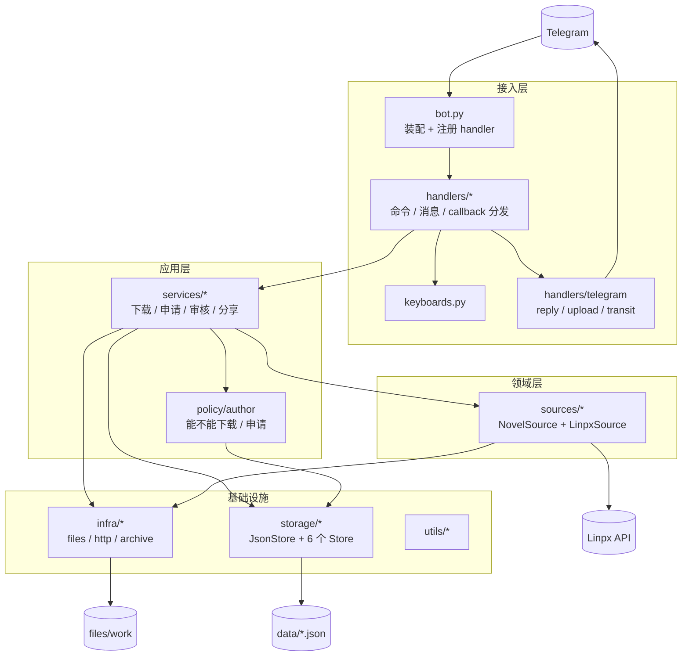

# 03 · 项目架构说明

> 代码基线：2026-11-23（历史改写后提交号会变，故只记日期）
> 本文回答「系统由哪些部分构成、边界在哪、哪里不好」。
> **调用链怎么走、改代码改哪一层 → 看 [04](04-如何改代码.md)；功能有没有 → 看 [01](01-功能清单与缺口.md)；时序图 → 看 [05](05-运行时序.md)；往哪走 → 看 [06](06-未来架构.md)；怎么装 / 怎么配 / 怎么跑 → 看 [07](07-配置与部署.md)；标签词表怎么写 → 看 [08](08-标签词表.md)。**

---

## 0. 一句话

**单体、事件驱动、分四层的 Telegram Bot**：

```text
handlers（接入） → services（用例编排） → sources（领域模型） → storage / infra（基础设施）
```

一个 Python 进程 + 一组 JSON 文件即可运行。没有任务队列、没有 Web 服务。

**三条红线**（自查命令见 §1）：

- `services/` 及以下**不 import telegram**：上传、删除、送审都通过回调注入；
- **只有 `storage/` 读写业务 JSON**：原子写 + mtime 热加载 + 进程内锁；
- 新增来源 = 实现 `NovelSource` + 在 `sources/__init__.py` 的 `_SOURCES` 注册一行。

---

## 1. 分层与依赖



### 依赖规则（可自查）

| 层 | 可以依赖 | **绝对不可以** |
|---|---|---|
| `handlers/` | telegram、services、policy、storage、sources、keyboards | — |
| `services/` | policy、sources、storage、infra、utils | **telegram** |
| `policy/` | storage（只读名单）、utils | services、telegram |
| `sources/` | infra、utils | services、telegram |
| `storage/` | infra、utils | services、telegram |
| `infra/` `utils/` | 彼此 | 任何上层 |

实测（2026-11-23）：`telegram` 只被 `handlers/` 下 **17 个文件** import，其余目录 0 处。自查命令见 **04 第 2.2 节**。

**依赖方向实测已干净**：`sources/` 不再 import `infra.files` / `infra.archive`，落盘、命名、压缩都下沉到 `services/packaging.py`，领域层可以脱离文件系统测试。

### 设计原则（代码里真实成立的）

| 原则 | 体现 |
|---|---|
| 单一入口 | 所有 Update 从 `bot.py` 进 |
| 回调集中路由 | `callbacks/router.py` 用字典分发 action |
| 用例收口 | 下载 / 申请 / 审核 / 分享都在 `services/` |
| 名单判定收口 | `policy/author.py` 一份规则，下载与申请共用 |
| 管理员判定收口 | `policy/admin.py` 按中转频道权限判定，不维护 ID 名单 |
| 来源适配 | `NovelSource` 抽象 + `_SOURCES` 注册表 |
| 文件即状态 | JSON + mtime 热加载，零外部依赖 |
| 即传即删 | 上传后 `remove_file` |
| 缓存优先 | `file_id` 缓存 + 分享冷却 |

---

## 2. 目录与职责

### 2.1 目录树

```text
FurryReadingBot/
├─ bot.py                  # 入口：装配 Application，注册 8 个命令 / 2 个消息 / 1 个 callback
├─ config.py               # 从 .env 读配置（频道、分享模式、冷却、缓存 TTL）
├─ keyboards.py            # 全部 InlineKeyboardMarkup（纯展示）
├─ handlers/               # 接入层：命令、私聊消息、图片
│  ├─ start.py             #   /start /help /ping
│  ├─ author.py            #   /black 申请下架、/furry 申请兽人作者
│  ├─ download.py          #   /down 与私聊链接：解析 → 权限 → 出下载菜单
│  ├─ review.py            #   /review 重推待审申请
│  ├─ sync.py              #   /sync 同步运营数据到私有仓库
│  ├─ media.py             #   私聊截图：作者下架材料
│  ├─ callbacks/           #   callback_data 分发与各业务展示（router + 6 个业务模块）
│  └─ telegram/            #   Telegram 适配：reply / upload / transit / membership / takedown
├─ services/               # 应用层：用例编排，不 import telegram
├─ policy/                 # 规则层：只回答「能不能」，不读写业务数据
├─ sources/                # 领域层：来源适配（linpx 可用；pixiv 仅 URL 工具，未接入）
├─ storage/                # 存储层：全仓唯一读写 JSON 的地方
├─ infra/                  # 基础设施：http（aiohttp 会话复用）/ files / archive（pyzipper AES）
├─ utils/                  # 通用工具：json（JsonDict）/ links / time / timer
├─ data/                   # 运行数据（JSON + tags.toml；不放脚本）
├─ data.example/           # 数据模板（含一份公开兽人作者名单 + 空记录 + tags.toml 词表样例）
├─ files/work/             # 下载打包目录（gitignore，每次下载独立子目录，交付后删除）
├─ deploy/                 # 部署：bot unit + 数据同步 service / timer（路径按实际部署改）
├─ script/                 # 运维脚本：sync_data.{sh,ps1}（把 data/ 提交到私有仓库）
├─ docs/                   # 01~08 设计 / 流程 / 改代码 / 部署 / 标签词表文档
└─ test/                   # pytest 用例（382 collected；词表由 test/conftest.py 固定为样例词表）
```

> 安装、配置、启动、部署的完整步骤见 [07 §1~§8](07-配置与部署.md)，本文只讲「每块代码负责什么」。

### 2.2 逐项职责

| 路径 | 职责 | 关键点 |
|---|---|---|
| `bot.py` | 装配 `Application`，注册 8 命令 + 2 消息 + 1 callback | 只做装配；`concurrent_updates(CONCURRENT_UPDATES)` 并行处理 update（默认 8）；`post_shutdown` 走 builder 注册，退出时关 aiohttp 会话 |
| `config.py` | 从 `.env` 读 7 个变量（含 2 个未使用的 GROUP） | 启动前 `config_errors()` 校验必需项（缺失直接退出）；评分阈值 / 分享冷却 / 文件缓存 TTL / update 并发数是文件内**代码常量**，不走 `.env` |
| `keyboards.py` | 生成 `InlineKeyboardMarkup` | 12 个在用，1 个零引用（`check_novel_keyboard`） |
| `handlers/start.py` | `/start` `/help` `/ping` | 只放通用命令 |
| `handlers/author.py` | `/black` 申请下架、`/furry` 申请兽人作者 | 参数为作者 ID / 主页链接，归一化成标准作者链接后出确认键盘 |
| `handlers/download.py` | 私聊/`/down`：解析 → 权限 → 出菜单 | 直接调 `DownloadService` |
| `handlers/review.py` | `/review` 重推待审 | 仅中转频道管理员（`AdminPolicy`） |
| `handlers/sync.py` | `/sync` 先让 `services.import_author_service` 合并推荐作者，再调用 `script/sync_data.sh`（Windows 为 `sync_data.ps1`）提交运营数据 | 仅中转频道管理员（`AdminPolicy`，默认拒绝）；推荐作者结果与结论一起回显，脚本原文只在失败 / 超时时用 `<pre>` 贴出并截断（成功时结论已足够，不贴原文） |
| `handlers/callbacks/router.py` | 按 action 分发到 6 个 callback 模块 | 未注册的 action 回「暂不支持」 |
| `handlers/callbacks/{download,apply,author,review,blacklist,share}.py` | 各业务在 Telegram 侧的展示逻辑 | 不写业务规则，只调 service |
| `handlers/telegram/reply.py` | 统一回复 | **默认 3 秒后删消息** |
| `handlers/telegram/upload.py` | `send_document`（本地文件或 `file_id`） | 只管发送；`file_id` 缓存由 `DownloadService.deliver` 在发送成功后写入 |
| `handlers/telegram/transit.py` | 中转频道卡片 + 审核键盘 | 未配频道返回 `False`（handler 据此提示「没能送到管理员」） |
| `handlers/telegram/membership.py` | 查中转频道成员状态 | `get_chat_member` + 60 秒缓存；查不到按非管理员 |
| `services/download_service.py` | 检查 / 权限 / 缓存 / 抓取 / 保存 / 上传编排 | 不 import telegram，`upload` 回调注入；权限问 `AuthorPolicy`；同一链接串行（`asyncio.Lock`，按事件循环分组） |
| `services/packaging.py` | 落盘 / 命名 / 压缩（单篇 txt、系列 txt / zip、作者全量 zip） | 每次打包用 `files/work/dl-*` 独立目录，交付后整目录删除；章节限并发 4 |
| `services/apply_service.py` | 名单校验 / 重复待审 / 写记录 / 送审 | 不 import telegram，`send_transit` 回调注入；名单校验问 `AuthorPolicy` |
| `policy/author.py` | 黑名单 / 兽人作者名单判定 | 纯判定，只读 `ListManager`；`can_download` / `can_apply` |
| `policy/admin.py` | 管理员判定 | 只看频道成员状态（`creator` / `administrator`）；默认拒绝 |
| `services/review_service.py` | 审核状态 + 名单 + 幂等 + 回滚 | `set_status(expected)` |
| `services/share_service.py` | 冷却 / 并发 / 缓存 / 频道 / 记录 | 目标频道由 `SHARE_MODE` 决定（test / prod） |
| `services/takedown_service.py` | 按作者下架历史分享 | 不 import telegram，`delete` 回调注入；失败的消息保留记录；下架核验通过后由 handler 调用 |
| `services/sync_service.py` | 执行同步脚本、超时、输出收集；`import_author` 时先合并推荐作者 | Linux 用 `/bin/bash script/sync_data.sh`、Windows 用 `powershell.exe -File script/sync_data.ps1`；脚本自己 `cd` 到 `../data`；进程内按事件循环串行；抓推荐作者失败不阻止提交 |
| `services/import_author_service.py` | 编排「拉推荐作者 → 过滤 → 并入兽人作者名单」 | 抓取走 `sources/linpx/client.get_fav_users()`，落盘走 `storage` 的 `add_many`；已收录 / 黑名单作者跳过；网络失败返回 `ImportAuthorResult(ok=False)`，不抛异常 |
| `services/tag_service.py` | 标签接线：装配留档 + 运营读写 | 启动调 `install_tag_archive()`；`sources.tags` 只留回调位 `set_unknown_recorder()`，不 import storage |
| `handlers/telegram/takedown.py` | 删除频道消息适配 | `chat_id` 归一化；「消息已不存在」视为成功；`takedown_author` 供 `rby` 使用 |
| `storage/black_request.py` | 作者下架申请（截图 / 状态 / 30 分钟有效期） | key 为 `author_id`，重复申请累计 `count` |
| `services/blacklist_service.py` | 受理 / 材料提交 / 核验 | 通过 = 加黑名单 + 移出兽人名单；下架由 handler 接下架服务 |
| `handlers/callbacks/blacklist.py` | `ab` / `aby` / `rby` / `rbn` | 删中转卡片、下架历史分享、私聊通知 |
| `handlers/media.py` | 私聊图片 → 下架材料 | 没有待提交申请时静默 |
| `sources/base.py` | `Novel` / `Series` / `Author` / `NovelSource` | 保留 `.id` `.title` `.url` 别名；`__post_init__` 调 `canonicalize_tags()`，**构造即规范化标签**（txt 头部 / 文案 / 缓存自动一致） |
| `sources/__init__.py` | `_SOURCES` 注册表 + `fetch` / `resolve_link` / `resolve_source` / `work_url` | 新增来源只需加一行；不落盘 |
| `sources/linpx/` | `client` / `parse` / `format` / `urls` / `config` / `errors` | 唯一可用来源 |
| `sources/pixiv/` | 只有 URL 拼接工具 | 未注册、未实现 client |
| `sources/utils.py` | `is_real_series`：判断合并 txt 还是分包 zip | 章节标题数字覆盖率 ≥ 75% |
| `sources/tags.py` | 标签词表：加载 / 校验 / 解析 / 入口规范化 | `Vocabulary` + `get_vocabulary()`（进程内单例）+ `canonicalize_tags()`（模型层调用）+ `display_tags()`（展示限流 + 评级互斥）；**不写盘**，未识别写法通过 `set_unknown_recorder()` 回调交给 services；TOML 的 `print` 只控制分类节点自身是否输出（`parts` / 纯 atomic 禁用），Python 内部用 `print_self`；守门用例见 [08](08-标签词表.md) |
| `storage/json_store.py` | JSON 存储基类 | 原子写、mtime 热加载、RLock、`prune` 钩子 |
| `storage/author_list.py` | `AuthorListStore` + `ListManager` | 名单读写；`add_blacklist` **不清** `furrylist` |
| `storage/furry_request.py` | 申请记录与状态流转 | `submit` 累计次数 |
| `storage/file_cache.py` | `file_id` 缓存 | key `kind:id:type`；TTL + prune |
| `storage/share_records.py` | 分享记录与冷却 | key `kind:id` |
| `storage/unknown_tags.py` | 未识别标签表 | 键 `normalize()` 后的写法；`count` 按作品数；不自动淘汰，`forget()` / `prune()` 手动清 |
| `infra/files.py` `infra/http.py` `infra/archive.py` | 文件 / HTTP / 压缩 | 同步核心 + `asyncio.to_thread` 异步包装；aiohttp 会话按事件循环复用；pyzipper 支持 AES；写失败原样抛 `OSError`（日志带路径 + `exc_info`） |
| `utils/{json,links,timer,time}.py` | `JsonDict` / 链接与 ID 提取 / 计时器 / 时间 | `JsonDict` 拼错字段静默返回 `None` |
| `data/*.json` | 运行时状态（名单 / 申请 / 缓存 / 分享 / 未识别标签） | `/sync` 先把 Linpx 推荐作者合并进名单，再提交 |
| `data/tags.toml` | 标签词表 | `/sync` 只提交 `*.json`；改词表要在数据目录手动提交，见 [08](08-标签词表.md) |
| `script/` | 运维脚本 | `sync_data.sh` / `sync_data.ps1`：把 `data/` 提交到私有仓库（`/sync` 与定时任务共用，内部加锁） |
| `test/*.py` | 单元测试 | 382 项（全绿基线 379 passed / 3 skipped）；词表由 `test/conftest.py` 固定为样例词表 |

---

## 3. 数据契约

### 3.1 JSON 结构

所有文件同构：`updated_at` + 一个数据键。
（唯一的非 JSON 数据文件是 `data/tags.toml`：结构与编写规则见 [08 · 标签词表](08-标签词表.md)。）

**名单**（`furry_authors.json` / `black_authors.json`，键 `authors`）

```json
{
  "updated_at": "2026-11-11T00:00:00+0000",
  "authors": { "130586197": { "name": "吾寻", "note": "兽人作者申请通过" } }
}
```

`note` 只用于溯源：人工审核写入「兽人作者申请通过」，`/sync` 导入的推荐作者写
`Linpx`。导入只补新 key，不覆盖已有 note。

| 文件 | 键 | 字段 |
|---|---|---|
| `furry_request.json` | `furry_request` | `author_id` `author_name` `link` `user_id` `user_name` `status`(`pending`/`approved`/`rejected`) `created_at` `updated_at` `count` `note` |
| `black_request.json` | `black_request` | `author_id` `author_name` `author_url` `user_id` `user_name` `status`(`pending_material`/`pending_review`/`approved`/`rejected`) `photo_file_id` `created_at` `updated_at` `count` `note` |
| `files_cache.json` | `files` | `file_id` `file_name` `caption` `link` `author_id` `author_name` `score` `uploaded_at` `expires_at` |
| `share_records.json` | `shares` → 作者 id → `{kind}:{item_id}` | 作者层：`author_name`；作品层：`title` `share_count` `first_shared_at` `last_shared_at` `history`；消息层：`message_id` `sent_at` `user_id` `user_name` |
| `unknown_tags.json` | `tags` | 键是 `sources.tags.normalize()` 后的写法；字段 `text`（来源原样写法）`count`（带这个写法的作品数）`first_seen` `last_seen`；**不自动淘汰**，`forget()` 按条销账、`prune()` 手动瘦身 |

### 3.2 key 规则

| 用途 | 规则 | 示例 |
|---|---|---|
| 下载缓存 | `{kind}:{item_id}:{file_type}` | `novel:18012577:txt` |
| 分享冷却 | `{kind}:{item_id}` | `series:16181401` |
| 分享记录 | `作者 id` → `{kind}:{item_id}` → `频道 id` → 消息数组 | `"130586197" → "novel:123" → "-1001…" → [{message_id, sent_at, user_id, user_name}]` |
| 申请 / 名单 | `author_id` | `130586197` |
| 临时文件 | `files/work/dl-*/{title}.txt`（系列分包 / 作者全量先建目录再压缩） | `files/work/dl-k3j9/风举云飞.txt` |

### 3.3 callback_data

格式 `{action};{payload}`，用 `partition(";")` 拆。

| 前缀 | payload |
|---|---|
| `dn` `ds` `dst` `dsz` `dan` | 原始链接 |
| `ba` | 作者 / 作品链接（按名单决定回作者页还是申请页） |
| `ab` `aby` | 作者主页链接 |
| `af` `afy` | 作者或作品链接 |
| `rfy` `rfn` `rby` `rbn` `rbt` | 作者 ID |
| `snp` `sna` `snn` | `kind;item_id;file_type` |

已知风险：

- Telegram 限制 `callback_data` ≤ **64 字节**，超长 URL 可能截断；
- 无签名、无归属校验，理论上可伪造 action 与 payload；
- 不校验操作者是不是当初发起下载的人。

> 完整 action 对照表见 **04 第 3.3 节**。

### 3.4 外部 API

| 用途 | 地址 |
|---|---|
| 展示链接 | `https://linpx.ink/pixiv/novel/{id}` |
| 单篇正文 | `https://api.linpx.ink/pixiv/novel/{id}/cache` |
| 系列与章节 | `https://api.linpx.ink/pixiv/series/{id}/cache` |
| 作者作品列表 | `https://api.linpx.ink/pixiv/user/{id}/cache` |
| 推荐作者（`/sync` 合并名单用） | `https://api.linpx.ink/fav/user/cache` |

所有 Linpx 请求都带 `Referer: https://linpx.ink/`。

---

## 4. 架构上的优点

1. **用例已收口到 `services/`**。六条链路（下载 / 申请 / 审核 / 分享 / 下架申请 / 历史下架）都能脱离 Telegram 单测，这是 382 个测试能跑起来的前提。
2. **来源适配有扩展点**。`NovelSource` + `_SOURCES` 注册表，加新来源只需实现接口 + 注册一行。
3. **存储轻到极致**。`JsonStore` 统一了原子写、热加载、锁、prune，6 个 Store 各自只写几十行。
4. **`storage/` 是唯一的业务持久化层**。业务 JSON 只有它读写，`policy` / `services` 只调 `is_blacklisted()` / `get_valid()` / `set_status()` 这类语义方法；默认名单实例收口在 `storage.get_lists()`，策略 / 申请 / 下载 / 审核四处共用同一份。（`infra/files.py` 的 `read_json()` / `save_json()` 只给脚本与测试写临时文件，不碰 `data/*.json`。）
5. **缓存策略有效**。`file_id` 复用 + 分享冷却，显著减少重复上传和刷屏。

---

## 5. 架构上的问题

| 级别 | 问题 | 现状 / 影响 |
|---|---|---|
| ~~P0~~ | ~~分享目标写死 `TEST_CHANNEL`~~ | ✅ 已修：目标由 `SHARE_MODE` 决定，文案按实际频道渲染 |
| ~~P0~~ | ~~配置无启动校验~~ | ✅ 已修：`config_errors()` 按 `SHARE_MODE` 校验必需项，缺失直接退出并列出问题 |
| P0 | `callback_data` 可伪造 | 无签名、无归属校验 |
| P1 | 名单互不清 | `add_blacklist` 不清 `furrylist`；下架流程由 `blacklist_service` 显式移出 |
| P1 | 跨文件无事务 | `set_status(approved)` 与 `add_furrylist()` 分开，中途失败会出现「状态过了名单没加」；`ReviewService` 有回滚兜底，但窗口内仍不一致 |
| P1 | 章节限并发 + 重复 fetch | 预检 fetch 一次、打包时再 fetch 一次，请求翻倍；章节侧限并发 4（`packaging.FETCH_CONCURRENCY`） |
| P1 | 无任务队列、无进度 | 长下载占住 Update 处理链路 |
| ~~P1~~ | ~~分享记录无 `message_id`~~ | ✅ 已修：记录带 `message_id`，下架核验通过后自动删除 |
| ~~P1~~ | ~~`sources/` 直接落盘~~ | ✅ 已修：落盘 / 压缩下沉到 `services/packaging.py`，`sources/` 只返回模型 |
| P2 | JSON 全量重写 | 每次修改重写整个文件 |
| P2 | 进程内锁 | `RLock` 只管单实例，多实例会互相覆盖 |
| P2 | 无 lint / format / type | tab 与空格混用，重构风险高 |
| ~~P2~~ | ~~`pytest` 列在运行时依赖~~ | ✅ 已修：移到 `pyproject.toml` 的 `[dependency-groups].dev` |
| P2 | 无 Dockerfile / 健康检查 / 指标 | `deploy/` 只有 bot unit 与数据同步 timer，健康检查 / 指标仍缺 |

### 已经解决的问题（别再当 bug 报）

| 曾经的问题 | 现状 |
|---|---|
| 审核与 `/review` 无权限校验 | ✅ 已修：`policy/admin.py` 按中转频道管理员身份判定，无 ID 名单 |
| 测试失效、`test_list.py` 写真实 `data/` | ✅ 已修：382 项全部用 `tmp_path`，`test_linpx.py` 的联网用例默认跳过 |
| JSON 写入不是原子操作 | ✅ 已修：临时文件 + `os.replace` |
| HTTP 会话不复用 | ✅ 已修：按事件循环复用，`bot.py` 退出时关闭 |
| 同步 / 异步两套工具重复 | ✅ 已修：单套同步核心 + 异步包装 |
| 配置无启动校验 | ✅ 已修：`config_errors()` 在 `bot.py` 启动前检查，缺失直接退出并列出问题 |
| 作者全量下载残留目录 / `sources/` 落盘 | ✅ 已修：`services/packaging.py` 每次下载独立工作目录，交付后整目录删除 |
| `README` 只有标题 | ✅ 已修：现在是面向用户的介绍（这是什么 / 能做什么 / 怎么用 / 命令 / FAQ / 文档入口 / 免责）；安装与配置在 [07](07-配置与部署.md)，架构在本文 |

---

## 6. 演进建议

### 三阶段

1. **先修 P0**：启动校验（已修）、伪造回调（分享目标已修）。
2. **再抽 `policy/`、修正依赖方向**：名单与管理员判定已收口到 `author` / `admin`；`sources/` 已不落盘（落盘在 `services/packaging.py`）。
3. **最后按数据量决定**是否上任务队列——现在还为时过早。

### 目标形态

`policy/` 的完整目录树、每条规则的当前落点、实施顺序，都在 **[06 · 未来架构](06-未来架构.md)**。

一句话：**`policy` 回答「能不能」，`storage` 回答「存在哪」，`services` 回答「按什么顺序做」。**

### 迁移步骤

| 步骤 | 动作 | 状态 |
|---|---|---|
| 1 | 修测试、统一 `tmp_path` | ✅ |
| 2 | `policy/admin.py`，保护 `/review` 与审核回调 | ✅（按中转频道管理员身份，无需 `ADMIN_IDS`） |
| 3 | 分享目标改配置，记录 `message_id` | ⚠️ 部分（`SHARE_MODE` 分流 + `message_id` 已做；频道仍是固定 env，不是可配置列表） |
| 4 | 抽出 `download_service` | ✅ |
| 4.5 | 抽出 `apply_service` | ✅ |
| 4.6 | 抽出 `review_service`（含幂等 + 回滚） | ✅ |
| 4.7 | 抽出 `share_service` | ✅ |
| 4.8 | 名单默认实例收成 `storage.get_lists()` 单例 | ✅（策略 / 申请 / 下载 / 审核共用，避免互相覆盖） |
| 5 | `Source` 只返回模型，写文件 / 压缩下沉到 services | ✅（`services/packaging.py`） |
| 6 | 名单判定统一到 `author` | ✅（只读黑名单 + 兽人作者名单） |
| 7 | 审核单事务 / 幂等 | ⚠️ 部分（已做 `set_status(expected)` + 回滚） |
| 8 | JSON 原子写 | ✅ |
| 9 | 长任务接入 `JobQueue` 或独立 worker | ❌ |
| 10 | 指标、告警、Dockerfile、部署文档 | ❌ |

### 不建议现在做的事

- **不要上微服务**：当前体量单体 + 清晰分层足够。
- **不要为「自动识别兽人内容」引入大模型**：标签 / 关键词 + 人工审核更可控。
- **不要在没有测试的情况下大改目录**：先补测试再重构。

---

## 7. 验证

```powershell
# 语法
.venv\Scripts\python.exe -m compileall -q bot.py config.py handlers services policy sources storage infra utils script

# 不启动轮询，只验装配
.venv\Scripts\python.exe -c "import bot; print('import ok')"

# 测试（382 项；全绿基线 379 passed / 3 skipped）
.venv\Scripts\python.exe -m pytest test -q
# 跳过真实 API 用例（368 项）
.venv\Scripts\python.exe -m pytest test -q --ignore=test/test_linpx.py
```

> 「改哪层跑哪个测试」的映射表见 **04 第 5.1 节**。

手工冒烟（需要真实 Token 与频道）：

1. 私聊发一个兽人作者的单篇链接 → 能收到 txt。
2. 点分享 → 目标频道收到文件（`SHARE_MODE=test` 时为 `TEST_CHANNEL`）。
3. 发一个未收录作者的链接 → 出现申请按钮。
4. 在中转频道点通过 → 作者进 `furry_authors.json`，申请人收到私聊。
5. 执行 `/review` → 无待审时返回「当前没有待审核申请」。

