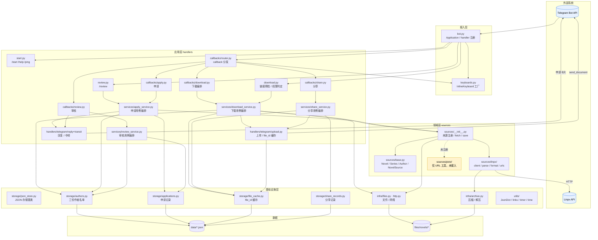
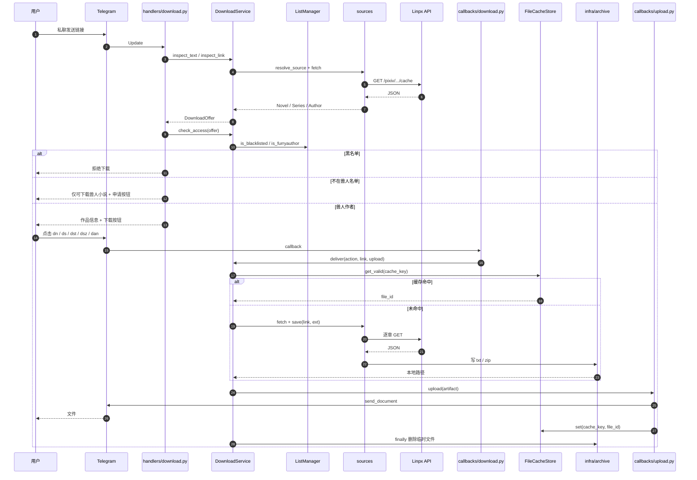
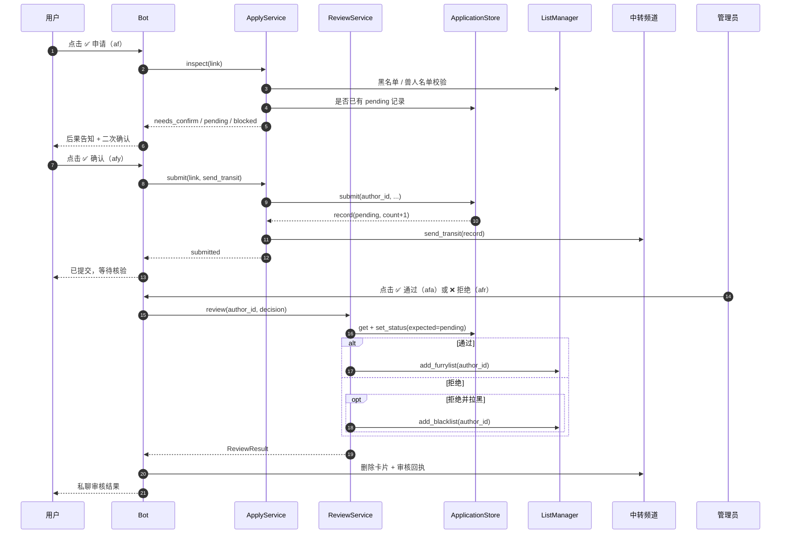
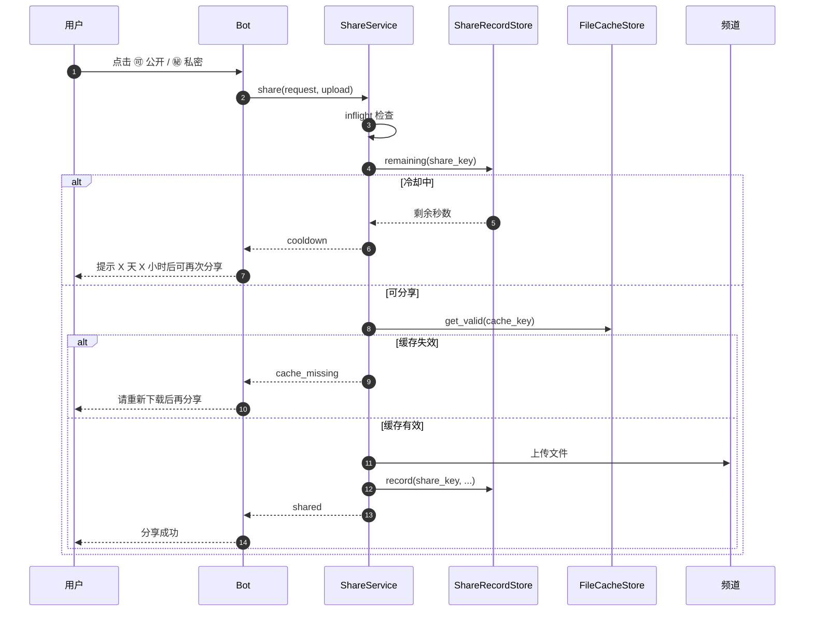
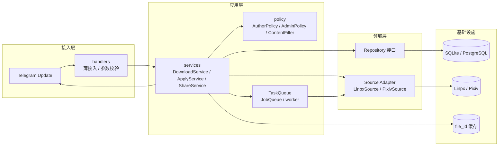

# 03 · 项目架构说明

> 项目：FurryReadingBot
> 代码基线：`933cb51` + 文档同步
> 核对日期：2026-11-11
> 阅读顺序建议：先看第 1 节总览与第 3 节文件职责，再看第 5、6 节的优劣分析。

---

## 0. 架构一句话

这是一个**单体、事件驱动、分层但不完全解耦**的 Telegram Bot：

- 接入层：`bot.py` + `handlers/` 接收 Telegram Update；
- 应用层：`services/` 编排下载用例，`handlers/callbacks/` 负责申请、审核、分享等 Telegram 交互；
- 领域层：`sources/` 把 Linpx 数据转换成 `Novel` / `Series` / `Author`；
- 基础设施层：`storage/` 负责 JSON 名单、缓存、文件与 zip；
- 外部依赖：Telegram Bot API、Linpx API。

没有数据库、没有独立任务队列、没有 Web 服务；一个 Python 进程 + 一组 JSON 文件即可运行。

---

## 1. 架构总览

### 1.1 分层图



### 1.2 依赖方向

```text
bot.py
  → handlers/*
      → handlers/callbacks/*
          → services/*          （下载 / 申请 / 审核 / 分享用例编排）
          → storage/*          （分享记录、上传缓存等）
          → keyboards.py
      → services/*              （链接检查、权限、申请/审核检查）
      → storage/authors.py
      → sources/*
  → config.py

services/*
  → sources/*                   （fetch / save / resolve）
  → storage/*                   （file_id 缓存、名单、文件清理）
  → infra/*                     （文件 / HTTP / 压缩）
  → utils/*

sources/*
  → infra/files.py、infra/http.py、infra/archive.py
  → utils/*

storage/*
  → storage/json_store.py       （JSON 存储基类）
  → utils/*

infra/*
  → utils/*
```

可以看到：

- `handlers` 依赖 `services` / `sources` / `storage` / `infra`，下载 / 申请 / 审核 / 分享链路已经通过 `services` 收口；
- 但 `sources` 仍反向依赖 `infra`（领域层直接落盘 / 压缩），这是下一阶段要处理的问题；
- `keyboards.py` 依赖 `sources.linpx.urls`，UI 层依赖具体来源；
- 下载 / 申请 / 审核 / 分享均已抽到 `services`；handler 主要剩 UI 与 Telegram 适配。

### 1.3 设计原则（代码中实际体现的）

| 原则 | 体现 |
|---|---|
| 单一入口 | 所有 Update 从 `bot.py` 进入 |
| 回调集中路由 | `handlers/callbacks/router.py` 用字典分发 action |
| 关注点分离 | 申请 / 审核 / 下载 / 分享拆成独立模块 |
| 来源适配 | `NovelSource` 抽象 + `_SOURCES` 注册表 |
| 文件即数据库 | JSON + mtime 热加载，无外部依赖 |
| 即传即删 | 上传后 `remove_file`，减少磁盘占用 |
| 缓存优先 | `file_id` 缓存 + 分享冷却，降低重复上传 |
| 异步优先 | aiohttp / aiofiles / `asyncio.to_thread` |

---

## 2. 关键运行时序

### 2.1 下载时序



### 2.2 申请 / 审核时序



> 注意：`ReviewService` 已使用 `set_status(..., expected=PENDING)` 保证幂等；跨进程 JSON 写入仍需要原子写或数据库事务。

### 2.3 分享时序



---

## 3. 目录与文件职责

### 3.1 目录树（带注释）

```text
FurryReadingBot/
├── bot.py                          # 入口：构建 Application、注册命令/消息/回调、run_polling、错误日志
├── config.py                       # 读取 .env：BOT_TOKEN、频道、冷却天数、缓存天数
├── keyboards.py                    # 所有 InlineKeyboard 工厂：下载、申请、审核、分享、书源导入
├── pyproject.toml                  # 项目元数据与依赖（python-telegram-bot / aiohttp / pyzipper 等）
├── uv.lock                         # uv 锁文件
├── README.md                       # 项目说明（当前只有一行标题）
├── Upgrade.md                      # 产品改造方案：分流、黑白名单、人工核验
├── .env.example                    # 环境变量模板
├── .gitignore                      # 忽略 .env / .venv / files / 部分 data 缓存
│
├── handlers/                       # 接入层：Telegram 命令与消息
│   ├── __init__.py                 # 汇总导出 start / help_cmd / ping / download / review / button_callback
│   ├── start.py                    # /start /help /ping
│   ├── download.py                 # 链接 -> 调用 DownloadService 检查 -> 渲染信息/键盘
│   ├── review.py                   # /review：重推所有 pending 申请到中转频道
│   ├── telegram/                   # Telegram 专属副作用
│   │   ├── __init__.py             # 导出 reply / upload_file / send_to_transit
│   │   ├── reply.py                # 统一回复、延时删除
│   │   ├── upload.py               # file_id 复用、send_document、写缓存、清理
│   │   └── transit.py              # 中转频道 caption、送审消息、审核键盘
│   └── callbacks/                  # 应用层：InlineKeyboard 回调
│       ├── __init__.py             # 只导出 button_callback
│       ├── router.py               # action -> 处理函数；统一异常兜底
│       ├── apply.py                # af 后果告知 / afy 提交申请
│       ├── review.py               # afa 通过 / afr 拒绝 / afb 拒绝并拉黑 + 通知申请人
│       ├── download.py             # dn/ds/dst/dsz/dan：Telegram 展示 + 上传适配
│       └── share.py                # snp/sna/snn：状态映射 + 上传适配
│
├── sources/                        # 领域层：小说来源适配
│   ├── __init__.py                 # 来源注册表；fetch / resolve_link / save 统一入口
│   ├── base.py                     # Novel / Series / Author 数据类；NovelSource 抽象基类
│   ├── format.py                   # 简介清洗、单篇文本、系列文本、章节标题格式化
│   ├── utils.py                    # get_id、is_real_series（判断真系列）
│   ├── linpx/                      # Linpx 来源实现
│   │   ├── __init__.py             # LinpxSource：fetch / save novel / series / author
│   │   ├── client.py               # aiohttp 请求 Linpx API，返回 JsonDict
│   │   ├── config.py               # BASE / API_BASE / HEADERS / 链接正则
│   │   ├── errors.py               # LinpxError / NotFound / Parse / Network
│   │   ├── parse.py                # JSON -> Novel / Series / Author
│   │   └── urls.py                 # 网页与 API URL 拼接
│   └── pixiv/                      # Pixiv 来源脚手架（未接入）
│       ├── config.py               # Pixiv BASE / API_BASE / HEADERS
│       └── urls.py                 # Pixiv URL 拼接（存在未使用/拼接错误）
│
├── services/                       # 业务服务层
│   ├── __init__.py                 # 导出下载 / 申请 / 审核 / 分享服务与结果类型
│   ├── apply_service.py            # 申请检查 / 重复待审 / 写入记录 / 送审编排
│   ├── review_service.py           # 审核状态 / 名单更新 / 幂等 / 失败回滚
│   ├── share_service.py            # 分享冷却 / 缓存 / 频道 / caption / 上传 / 记录
│   └── download_service.py         # 链接检查 / 权限 / 缓存 / 抓取 / 保存 / 上传编排
│
├── storage/                        # 仓储层：业务数据 JSON 存储
│   ├── json_store.py               # JsonStore：原子写、mtime 热加载、RLock、prune 钩子
│   ├── applications.py             # ApplicationStore：申请记录、pending/approved/rejected
│   ├── authors.py                  # AuthorListStore + ListManager：白名单/黑名单/兽人名单
│   ├── file_cache.py               # FileCacheStore：file_id、TTL、过期清理
│   └── share_records.py            # ShareRecordStore：分享冷却、次数、TTL
│
├── infra/                          # 基础设施：文件 / HTTP / 压缩
│   ├── files.py                    # safe_filename、read/save/remove；同步核心 + 异步包装
│   ├── http.py                     # aiohttp 会话复用 + requests 同步兜底
│   └── archive.py                  # zip / unzip；AES、递归解压、线程池异步包装
│
├── utils/                          # 通用工具
│   ├── json.py                     # JsonDict：支持属性访问的 dict
│   ├── links.py                    # 从文本提取 URL、提取数字 ID
│   ├── time.py                     # UTC 时间与 ISO 解析
│   └── timer.py                    # 同步/异步函数耗时装饰器
│
├── data/                           # 运行数据
│   ├── furry_authors.json          # 兽人作者名单（业务主数据）
│   ├── black_authors.json          # 作者黑名单
│   ├── white_authors.json          # 授权转载白名单（当前未使用）
│   ├── apply_authors.json          # 申请记录（已跟踪；.gitignore 对其无效）
│   ├── files_cache.json            # file_id 缓存（已跟踪；.gitignore 对其无效）
│   ├── share_records.json          # 分享记录（已跟踪；.gitignore 对其无效）
│   ├── get_authors_data.py         # 同步脚本：从 Linpx 推荐作者导入兽人名单
│   └── get_authors_data_async.py   # 异步版导入脚本
│
├── files/novels/                   # 下载产物临时目录（gitignore）
├── docs/                           # 本项目文档（功能 / 流程 / 架构）
│
└── test/                           # pytest 用例
    ├── test_application.py         # 申请记录：持久化、累计、状态流转
    ├── test_apply.py               # 申请数据解析与文案（部分已过期）
    ├── test_file_cache.py          # file_id 缓存 TTL 与清理
    ├── test_linpx.py               # Linpx 解析与真实 API（部分已过期）
    ├── test_list.py                # 名单增删与持久化（使用 tmp_path，不污染 data）
    └── test_share_record.py        # 分享冷却与 TTL
```

### 3.2 根目录文件

| 文件 | 主要符号 | 职责 | 备注 |
|---|---|---|---|
| `bot.py` | `main`、`error_handler` | 构建 `Application`、注册 handler、`run_polling` | 未配置并发；错误只记日志 |
| `config.py` | `BOT_TOKEN`、`TRANSIT_CHANNEL`、`SHARE_COOLDOWN_DAYS`、`FILE_CACHE_TTL_DAYS` | 读取 `.env` 并提供默认值 | 无格式 / 必填校验 |
| `keyboards.py` | `down_*`、`apply_*`、`review_author_keyboard`、`share_novel_keyboard` | 生成内联键盘 | `afb` / `check_novel_keyboard` / `import_to_legado_keyboard` 未接入 |
| `pyproject.toml` | dependencies | 依赖声明 | `pytest` 被列为运行时依赖；无 lint/type 配置 |
| `.env.example` | — | 环境变量模板 | 与 `config.py` 保持一致 |
| `Upgrade.md` | — | 产品目标与流程设计 | 当前实现与其存在差距 |

### 3.3 handlers 模块

| 文件 | 主要函数 | 职责 | 关键点 |
|---|---|---|---|
| `handlers/start.py` | `start`、`help_cmd`、`ping` | 基础命令 | `/start` 文案过时；`/ping` 用于取 chat_id |
| `handlers/download.py` | `download` | 调用 service 检查链接/权限，渲染作品信息与键盘 | 权限判定在 `DownloadService` |
| `handlers/review.py` | `review` | 通过 `ApplyService.pending_records()` 重推待审申请 | 无管理员校验；无分页 |
| `handlers/callbacks/router.py` | `button_callback` | action 分发、统一异常兜底 | `ignore/not_furry/nfa` 直接删消息 |
| `handlers/callbacks/apply.py` | `apply_notice`、`edit_or_reply`、`apply_furry`、`apply_furry_confirm` | 用户侧申请 UI | 校验/提交由 `ApplyService` 负责 |
| `handlers/callbacks/review.py` | `review_application`、`apply_approve/reject/blacklist`、`notify_applicant` | 审核回执 / 通知 / 中转消息 | 状态与名单由 `ReviewService` 负责；`afb` 仍无 UI |
| `handlers/callbacks/download.py` | `download`、`choose_series_format` | Telegram callback + 上传适配 | 缓存/抓取/保存由 `DownloadService` 负责 |
| `handlers/callbacks/share.py` | `share`、`share_public/private/reject`、`format_remaining` | 分享状态映射 / Telegram 上传适配 | 冷却、inflight、缓存、频道由 `ShareService` 负责；目标频道仍默认 `TEST_CHANNEL` |

### 3.4 sources 模块

| 文件 | 主要符号 | 职责 | 关键点 |
|---|---|---|---|
| `sources/__init__.py` | `_SOURCES`、`resolve_source`、`fetch`、`resolve_link`、`save` | 来源注册与统一入口 | `source is None` 未处理；`save` 负责选具体保存方式 |
| `sources/base.py` | `Novel`、`Series`、`Author`、`NovelSource` | 领域模型与来源接口 | 只有 novel 方法是 `@abstractmethod`；其余是空实现 |
| `sources/format.py` | `format_caption`、`format_novel_text`、`format_series_text`、`format_chapter_title` | 文本清洗与拼装 | `format_chapter_title` 当前未被使用 |
| `sources/utils.py` | `get_id`、`is_real_series` | 正则取 ID、判断真系列 | 数字覆盖率阈值 0.75 写死 |
| `sources/linpx/__init__.py` | `LinpxSource` | 单篇 / 系列 / 作者抓取与落盘 | 逐章串行；作者目录不清理；含开发用 `main()` |
| `sources/linpx/client.py` | `get_novel`、`get_series`、`get_author` | 调 Linpx API | 返回 `JsonDict`；错误由 `get_json` 吞掉返回 `None` |
| `sources/linpx/parse.py` | `json_to_novel`、`json_to_series`、`json_to_author` | JSON → 领域模型 | `error` 时抛 `LinpxNotFoundError` |
| `sources/linpx/config.py` | 正则、BASE、HEADERS | 链接识别与 API 地址 | 只识别 linpx / furrynovel 域名 |
| `sources/linpx/errors.py` | `LinpxError` 家族 | 错误分类 | 上层未细分处理 |
| `sources/linpx/urls.py` | `url_novel`、`url_series`、`url_author` | URL 拼接 | 同时提供网页与 API 地址 |
| `sources/pixiv/config.py` | BASE / API_BASE | Pixiv 配置 | 未使用 |
| `sources/pixiv/urls.py` | `url_*` | Pixiv URL 拼接 | 未注册；`url_user` 有反引号错误；`url_author_work_latest` 指向 all |

### 3.5 storage / infra 模块

| 文件 | 主要类 / 函数 | 职责 | 关键点 |
|---|---|---|---|
| `storage/json_store.py` | `JsonStore` | JSON 存储基类 | 原子写（临时文件 + `os.replace`）、mtime 热加载、RLock、`prune` 钩子 |
| `storage/authors.py` | `AuthorListStore`、`ListManager` | 白名单 / 黑名单 / 兽人名单 | 继承 `JsonStore`；多实例写入仍可能互相覆盖 |
| `storage/applications.py` | `ApplicationStore` | 申请记录与状态 | `submit` 累计次数并重置 pending；`set_status` 支持 `expected` |
| `storage/file_cache.py` | `FileCacheStore` | `file_id` 缓存 | key `kind:id:type`；TTL + prune |
| `storage/share_records.py` | `ShareRecordStore` | 分享记录与冷却 | key `kind:id`；冷却与保留期分离 |
| `infra/files.py` | `safe_filename`、`save_text`、`read_json`、`remove_file` | 文件工具 | 同步核心 + `asyncio.to_thread` 异步包装，运行时统一走异步接口 |
| `infra/http.py` | `get_json`、`download_json`、`get_json_sync` | HTTP 访问 | aiohttp 按事件循环复用会话；requests 作为同步兜底 |
| `infra/archive.py` | `zip_*`、`unzip_*` | 压缩 / 解压 | 同步实现 + 异步包装；使用 pyzipper，支持 AES；递归解压 |
| `utils/time.py` | `utc_now`、`utc_now_iso`、`parse_iso` | 时间工具 | 兼容 `+0000` 与 `+00:00` |

### 3.6 utils / data / test

| 文件 | 职责 | 备注 |
|---|---|---|
| `utils/json.py` | `JsonDict`：dict + 属性访问 + 递归转换 | 拼错字段返回 `None`，错误会被隐藏 |
| `utils/links.py` | `get_url`、`get_id` | 多 URL 时返回 list；`get_id` 取第一段数字 |
| `utils/timer.py` | `timer` 装饰器 | 同时支持同步/异步；会 print + logging |
| `data/get_authors_data.py` | 同步导入 Linpx 推荐作者到兽人名单 | 直接写真实 `data/furry_authors.json` |
| `data/get_authors_data_async.py` | 异步版导入 | 同上 |
| `test/test_application.py` | 申请记录单测（含 `set_status(expected)`） | 已迁移，10 个用例通过 |
| `test/test_apply.py` | apply handler：callback 解析、文案、af / afy 分支 | 已迁移，11 个用例通过 |
| `test/test_review_service.py` | 审核 service：状态、名单、幂等、回滚 | 新增，9 个用例通过 |
| `test/test_review.py` | review handler：回执、通知、ReviewService 接线 | 新增，8 个用例通过 |
| `test/test_share_service.py` | 分享 service：冷却、缓存、频道、上传、记录 | 新增，7 个用例通过 |
| `test/test_file_cache.py` | 缓存 TTL 与清理 | 通过 |
| `test/test_linpx.py` | Linpx 解析与在线抓取 | 接口已变化，且缺 `pytest-asyncio` |
| `test/test_list.py` | 名单增删 | 会写真实 data，需改为 `tmp_path` |
| `test/test_share_record.py` | 分享冷却与 TTL | 通过 |
| `test/test_download_service.py` | 下载 service：链接、权限、缓存、保存、上传编排 | 新增，17 个用例通过 |
| `test/test_apply_service.py` | 申请 service：名单、重复待审、写入、送审 | 新增，11 个用例通过 |

### 3.7 services 模块

| 文件 | 主要符号 | 职责 | 关键点 |
|---|---|---|---|
| `services/__init__.py` | `DownloadService`、`ApplyService`、`ReviewService`、`ShareService` 等 | 统一导出服务 API | handler 只从这里导入服务 |
| `services/download_service.py` | `inspect_text`、`inspect_link`、`check_access`、`prepare`、`deliver` | 下载用例编排 | 不 import telegram；上传通过 `upload` 回调注入 |
| `services/apply_service.py` | `inspect`、`submit`、`pending_records`、`get_applications` | 申请用例编排 | 不 import telegram；送中转通过 `send_transit` 回调注入 |
| `services/review_service.py` | `review`、`ReviewResult` | 审核用例编排 | `set_status(expected)` 幂等；名单失败回滚 |
| `services/share_service.py` | `share`、`ShareRequest`、`ShareResult` | 分享用例编排 | 冷却/inflight/缓存/频道/记录；上传通过回调注入 |

职责边界：

- **service 负责**：下载的链接/权限/缓存/抓取/保存/上传顺序；申请的名单校验/重复待审/写入记录/送审顺序；审核的状态/名单/幂等/回滚；分享的冷却/并发/缓存/频道/记录。
- **handler 负责**：`Update` / `CallbackQuery`、消息文案、键盘、`query.edit_message_text` / `delete_message`。
- **upload / transit 适配器负责**：`send_document`、多目标发送、写 `file_id` 缓存；发送中转频道卡片。

这样 `DownloadService` / `ApplyService` / `ReviewService` / `ShareService` 可以直接被单元测试覆盖，不需要构造 Telegram Update。

### 3.8 handlers/telegram 模块

| 文件 | 主要符号 | 职责 | 关键点 |
|---|---|---|---|
| `handlers/telegram/reply.py` | `reply` | 统一回复、延时删除 | 只处理 Telegram 消息 |
| `handlers/telegram/upload.py` | `get_cache`、`upload_file` | `send_document`、`file_id` 缓存、清理 | 上传成功后才写缓存 |
| `handlers/telegram/transit.py` | `send_to_transit`、`transit_author_caption` | 中转频道消息与审核键盘 | 未配置频道返回 `False` |

`handlers/callbacks/common.py`、`handlers/callbacks/upload.py` 及 `guess_kind` 已删除。

---

## 4. 数据契约与边界

### 4.1 JSON 数据结构

**作者名单**（`furry_authors.json` / `black_authors.json` / `white_authors.json`）

```json
{
  "updated_at": "2026-11-11T00:00:00+0000",
  "authors": {
    "130586197": {
      "name": "吾寻",
      "note": "兽人作者申请通过"
    }
  }
}
```

**申请记录**（`apply_authors.json`）

```json
{
  "updated_at": "2026-11-11T00:00:00+0000",
  "applications": {
    "130586197": {
      "author_id": "130586197",
      "author_name": "吾寻",
      "link": "https://linpx.ink/pixiv/user/130586197",
      "user_id": "42",
      "user_name": "Alice Wang",
      "status": "pending",
      "created_at": "2026-11-10T17:54:26+0000",
      "updated_at": "2026-11-10T17:54:48+0000",
      "count": 1,
      "note": ""
    }
  }
}
```

`status` 取值：`pending` / `approved` / `rejected`。

**file_id 缓存**（`files_cache.json`）

```json
{
  "updated_at": "2026-11-11T00:00:00+0000",
  "files": {
    "novel:18012577:txt": {
      "file_id": "BQACAgUAAx...",
      "file_name": "标题.txt",
      "caption": "标题\n作者：...\n标签：...",
      "uploaded_at": "2026-11-11T00:00:00+0000",
      "expires_at": "2026-11-18T00:00:00+0000"
    }
  }
}
```

**分享记录**（`share_records.json`）

```json
{
  "updated_at": "2026-11-11T00:00:00+0000",
  "shares": {
    "novel:18012577": {
      "kind": "novel",
      "item_id": "18012577",
      "title": "标题",
      "first_shared_at": "2026-11-11T00:00:00+0000",
      "last_shared_at": "2026-11-11T00:00:00+0000",
      "expires_at": "2026-12-11T00:00:00+0000",
      "count": 1,
      "last_user_id": "42",
      "last_user_name": "Alice",
      "last_chat_ids": ["-100123456"],
      "last_file_type": "txt",
      "public": true
    }
  }
}
```

### 4.2 key 规则

| 用途 | 规则 | 示例 |
|---|---|---|
| 下载缓存 | `{kind}:{item_id}:{file_type}` | `novel:18012577:txt` |
| 分享冷却 | `{kind}:{item_id}` | `series:16181401` |
| 申请记录 | `author_id` | `130586197` |
| 名单 | `author_id` | `130586197` |
| 临时文件 | `files/novels/{author}/{series}/{title}.txt` | `files/novels/吾寻/风举云飞.txt` |

### 4.3 callback_data 规则

格式：`{action};{payload}`，用分号分隔。

| 前缀 | payload | 示例 |
|---|---|---|
| `dn` / `ds` / `dst` / `dsz` / `dan` | 原始链接 | `dn;https://linpx.ink/pixiv/novel/18012577` |
| `af` / `afy` | 作者或作品链接 | `af;https://linpx.ink/pixiv/user/130586197` |
| `afa` / `afr` / `afb` | 作者 ID | `afa;130586197` |
| `snp` / `sna` / `snn` | `kind;item_id;file_type` | `snp;novel;18012577;txt` |

风险：

- Telegram 限制 `callback_data` ≤ 64 字节，直接放完整 URL 在极端长链接下可能超限；
- 没有签名 / 归属校验，理论上可以伪造 action 与 payload；
- 没有校验操作者是否就是当初发起下载的人。

### 4.4 外部 API

| 来源 | 地址 | 用途 |
|---|---|---|
| Linpx 页面 | `https://linpx.ink/pixiv/novel/{id}` | 生成对用户展示的链接 |
| Linpx 单篇 API | `https://api.linpx.ink/pixiv/novel/{id}/cache` | 拉取正文 |
| Linpx 系列 API | `https://api.linpx.ink/pixiv/series/{id}/cache` | 拉取系列与章节列表 |
| Linpx 作者 API | `https://api.linpx.ink/pixiv/user/{id}/cache` | 拉取作者作品列表 |
| Linpx 推荐作者 | `https://api.linpx.ink/fav/user/cache` | 批量导入兽人作者名单 |
| Telegram | Bot API | 消息、文件、频道 |

所有 Linpx 请求都带 `Referer: https://linpx.ink/`。

---

## 5. 当前架构的优势

### 5.1 分层清晰，入口单一

- 只有 `bot.py` 负责装配，命令 / 消息 / 回调三类入口一目了然。
- `handlers/callbacks/router.py` 把 action 映射集中到一张表，新增按钮只需要加一行映射 + 一个处理函数。
- 申请、审核、下载、分享各自独立文件，阅读时不需要在多个巨型文件之间跳转。
- 下载 / 申请 / 审核 / 分享链路已分别收口到 `services/` 下对应 service；handler 只保留 Telegram 展示与适配。

### 5.2 来源适配器具备扩展基础

- `Novel` / `Series` / `Author` 统一了不同来源的数据形态。
- `NovelSource` 抽象 + `_SOURCES` 注册表，理论上新增 Pixiv 来源只需要实现接口并注册。
- 解析与落盘分离：`parse.py` 只负责 JSON → 模型，`LinpxSource` 负责编排，`format.py` 负责文本。

### 5.3 存储实现轻量、可热更新

- 名单、申请、缓存、分享记录全部是 JSON，运营可以直接编辑，不需要数据库和迁移。
- `mtime` 检测让修改实时生效，不需要重启 Bot。
- `RLock` + 排序写盘保证了单进程内的基本安全。
- 对小型社区 Bot 来说，这是**运维成本最低**的方案。

### 5.4 缓存设计有效降低重复成本

- `file_id` 缓存让同一作品 7 天内重复下载几乎零成本。
- 系列 `auto` 会复用已有 txt / zip，避免重复抓取和压缩。
- 分享冷却 + `_inflight` 集合，避免同一作品被连续刷屏。
- `FileCacheStore` / `ShareRecordStore` 都有 TTL 清理，不会无限膨胀。

### 5.5 异步与线程池使用得当

- 网络请求使用 `aiohttp`，文件读写使用 `aiofiles`。
- 压缩 / 解压这类 CPU + 磁盘操作通过 `asyncio.to_thread` 放到线程池，不阻塞事件循环。
- 上传、下载、申请、分享都是 async handler，符合 PTB v20+ 的写法。

### 5.6 运营闭环基本成型

- 黑名单拒绝 → 兽人名单放行 → 未知作者申请 → 中转频道人工核验 → 结果私聊通知。
- 审核状态、申请次数、分享次数都有记录，具备基本的审计能力。
- `Upgrade.md` 中的「白名单优先、人工兜底、版权可响应」思路已经在代码中落地了一半。

### 5.7 代码量可控

- 全项目约 5300 行 Python（含注释与空行），核心业务文件多在 250 行以内，最大的 `infra/archive.py` 约 540 行、`services/share_service.py` 约 200 行。
- 没有引入 ORM、消息队列、Web 框架等重型依赖，部署只需要 Python + Token。
- 对个人 / 小团队维护友好。

---

## 6. 当前架构的不足

### 6.1 分层与依赖方向

| 问题 | 具体表现 | 影响 |
|---|---|---|
| 领域层反向依赖基础设施 | `sources/linpx/__init__.py` 直接 import `infra.files`、`infra.archive`，仍自行落盘 | 来源实现无法脱离本地文件系统测试；落盘 / 压缩策略仍由来源决定 |
| 业务编排散落在 handler | 下载 / 申请 / 审核 / 分享已抽到 `services/`；handler 主要剩 UI 与适配 | 四类主流程均可独立测试 |
| UI 依赖具体来源 | `keyboards.py` 直接 import `sources.linpx.urls.url_author` | 增加 Pixiv 等来源时，键盘层需要改 |
| 公共模块职责过多 | `callbacks/common.py` 同时负责回复、单例、申请文案、中转发送 | 任何一处变更都影响申请与审核两个模块 |
| 命名冲突 | `handlers/download.py` 与 `callbacks/download.py`；`handlers/review.py` 与 `callbacks/review.py` | 搜索、阅读、排错时容易看错文件 |
| 注册表硬编码 | `_SOURCES = [LinpxSource()]` | 增加来源要改入口文件，没有插件式注册 |

### 6.2 状态管理与并发

| 问题 | 具体表现 | 影响 |
|---|---|---|
| 全局单例分散 | `_applications`、`_file_cache`、`_share_records` 各自模块级单例；`ListManager()` 每次新建 | 状态来源不统一，测试困难 |
| 锁只在实例内 | 每个 Store 一个 `RLock`，多个 `ListManager` 实例不共享锁 | 并发写入可能丢失更新（读-改-写覆盖） |
| 多进程不安全 | JSON 全量重写，没有文件锁 | 多 worker / 多实例部署会互相覆盖 |
| check-then-act | 审核已由 `ReviewService` 使用 `set_status(expected)` 幂等；分享仍是先查冷却再写记录 | 审核主要竞态已修复；分享仍可能并发重复 |
| `_inflight` 只在内存 | 进程重启即丢失 | 重启窗口内可能重复分享 |
| 更新串行处理 | 未显式配置 `concurrent_updates` | 一个作者全量下载会阻塞其他用户 |
| handler 内 sleep | `reply(delete_after=3)` 在协程里 sleep | 占用任务 3 秒，放大串行影响 |
| 启动重放旧更新 | `run_polling(drop_pending_updates=False)` | 停机期间的旧消息会在启动后集中处理 |

### 6.3 错误处理与可观测性

| 问题 | 具体表现 | 影响 |
|---|---|---|
| 来源为空未处理 | `sources.fetch` 仍可能空来源；下载路径已由 `DownloadService.inspect_link` 前置检查 | 非下载调用方仍可能触发 `AttributeError` |
| 网络错误被吞 | `get_json` 捕获所有异常后返回 `None` | 上层拿到 `None` 才报错，丢失真实原因 |
| 文件写入失败仍返回路径 | `save_text` / `save_json` 失败只 log，仍 `return p` | 后续上传才报 `FileNotFoundError` |
| 异常兜底过宽 | `except Exception` + 回复 `f"处理失败：{e}"` | 可能向用户泄露内部细节，也不利于分类处理 |
| 错误只记日志 | `error_handler` 不通知用户、不告警 | 用户只看到无响应 |
| 定时删除可能抛错 | `reply` 中 `await message.delete()` 没有 try | 消息已被删除时会触发全局错误 |
| JSON 损坏无恢复 | `json.loads` 失败直接抛出 | Bot 可能在启动 / 首次访问时崩溃 |
| 配置无校验 | `float(os.environ.get(...))` 遇到非法值直接 ValueError | 启动即崩，且提示不明确 |
| 无指标 / 审计 | 只有零散 `logger.info` | 无法统计成功率、耗时、审核时效 |

### 6.4 权限与安全

| 问题 | 具体表现 | 影响 |
|---|---|---|
| 无管理员校验 | `/review`、`afa/afr/afb` 任何人都能触发 | 审核结果可被普通频道成员篡改 |
| 回调可伪造 | callback_data 只是 `action;payload`，无签名、无归属校验 | 知道 key 的人可以触发下载 / 分享 |
| 回调长度风险 | 完整 URL 直接放进 `callback_data` | 长链接可能超过 64 字节限制 |
| 无频率限制 | 下载、申请、分享都没有按用户限流 | 可被脚本刷爆 API / 磁盘 / 频道 |
| 路径未完全净化 | `save_author` / `save_series_zip` 直接用作者名、系列名拼目录 | 含 `../` 或非法字符时可能目录穿越 / 写失败 |
| 中转频道依赖人工保密 | 没有权限校验，只能靠频道私有 | 频道成员泄露即可越权审核 |
| 无版权下架机制 | 只能手工删消息、手工改 JSON | 作者投诉时响应慢 |
| 文件大小无上限 | 作者全量 zip 可能超过 Telegram 限制 | 上传失败且没有降级方案 |

### 6.5 性能与扩展性

| 问题 | 具体表现 | 影响 |
|---|---|---|
| 逐章串行 | `for novel_id in series.novel_ids: await fetch` | 长系列耗时线性增长 |
| HTTP 会话 | `infra/http.py` 按事件循环复用 `ClientSession` | 已完成；退出时由 `bot.py` 关闭 |
| 重复 fetch | 预检 fetch 一次，`save()` 再 fetch 一次 | 请求数翻倍，放大限流风险 |
| 无任务队列 | 下载在 handler 内同步完成 | 占用更新处理，无法削峰 |
| 无进度反馈 | 只有「正在获取文件」 | 长任务用户不知道是否卡死 |
| JSON 全量重写 | 每次新增/修改都重写整个文件 | 数据量增大后 I/O 成本上升 |
| 无元数据缓存 | 每次都请求 Linpx API | 热门作品重复请求 |
| 分享记录无 message_id | 只存 chat_ids | 无法自动删除历史分享 |

### 6.6 数据一致性

| 问题 | 具体表现 | 影响 |
|---|---|---|
| 写盘原子性 | `JsonStore` 使用临时文件 + `os.replace` | 已完成；仍无跨文件事务 |
| 跨文件无事务 | `set_status(approved)` 与 `add_furrylist()` 分开执行 | 中途失败会出现「状态已通过但名单没加」 |
| 名单语义重叠 | 黑名单、白名单、兽人名单三套数据，`add_blacklist` 不清 `furrylist` | 同一作者可能同时出现在多份名单，优先级靠代码约定 |
| 白名单未使用 | `white_authors.json` 无人读取 | 运营以为配置生效，实际无效 |
| 申请记录字段漂移 | `ApplicationStore` 没有 `kind`，旧测试却传 `kind` | 接口与测试脱节 |
| 时间格式混用 | `utc_now_iso()` 生成 `+0000`，部分解析兼容 `+00:00` | 基本可用，但外部工具可能不兼容 |

### 6.7 可运维性与工程质量

| 问题 | 具体表现 | 影响 |
|---|---|---|
| 目标频道写死 | `targets = TEST_CHANNEL` | 无法按环境切换正式 / 测试频道 |
| 配置无启动校验 | 缺 `TRANSIT_CHANNEL` 只 warning | 申请静默丢失 |
| 测试失效且污染数据 | 过期 import；`ListManager()` 写真实 `data/` | 无法回归，运行测试会改生产数据 |
| 依赖划分不清 | `pytest` 在 `[project].dependencies` | 生产镜像包含测试依赖 |
| 无 lint / format / type | 无 ruff / black / mypy 配置 | 制表符与空格混用，重构风险高 |
| 文档不足 | README 只有标题；`/start` 文案过时 | 新人上手成本高 |
| 无部署产物 | 无 Dockerfile / systemd / 健康检查 | 部署不可复现 |
| 死代码 / 未用 UI | `afb`、`check_novel_keyboard`、`import_to_legado_keyboard`、`sources/pixiv` | 误导维护者 |
| `JsonDict` 静默失败 | 拼错字段返回 `None` | 错误推迟到运行时才暴露 |
| 同步 / 异步重复 | ✅ 已合并到 `infra/files.py` / `infra/archive.py` | 已完成，单套同步核心 + 异步包装 |
| `.gitignore` 无效 | `data/apply_authors.json`、`files_cache.json`、`share_records.json` 已被跟踪 | 运行时数据变更仍会污染工作区 |

### 6.8 不足总结（按影响排序）


1. **P0**：审核无权限校验、分享目标写死、来源空值崩溃、作者临时目录残留、测试失效。
2. **P1**：缺少 service 层、跨文件事务、白名单未接入、逐章串行、无任务队列。
3. **P2**：JSON 存储上限、无指标告警、无部署文档、死代码与重复工具。

---

## 7. 目标架构与演进建议

### 7.1 目标分层



核心变化：

1. **新增 `services/`**：把下载、申请、分享的编排从 callback 中抽出来，callback 只做「解析参数 + 调用 service + 展示结果」。
2. **新增 `policy/`**：统一回答「这个用户能不能做这件事」，包括作者名单、管理员身份、申请冷却、内容过滤。
3. **新增 `repositories/`**：用接口隔离 JSON / SQLite / PostgreSQL，业务层不关心存储。
4. **来源适配器不落盘**：`Source` 只返回 `Novel` / `Series` / `Author` 或纯文本，写文件、压缩交给 service / storage。
5. **任务队列**：长下载从 Update 处理链路中移出，先回「已受理」，完成后推送文件。
6. **审计字段**：分享记录增加 `message_id`、`chat_id`、`author_id`，为「拉黑后下架」做准备。

### 7.2 建议的目录调整

```text
services/
├── download_service.py      # 缓存 -> fetch -> save -> upload 的编排
├── apply_service.py         # 申请校验、写入、送审
├── review_service.py        # 审核事务：状态 + 名单 + 通知
└── share_service.py         # 冷却、缓存、频道发送、记录

policy/
├── author_policy.py         # 黑名单 > 白名单 > 兽人名单 > 申请
├── admin_policy.py          # ADMIN_IDS + 频道管理员
└── content_policy.py        # 标签 / 正文关键词（可选）

repositories/
├── author_repository.py
├── application_repository.py
├── file_cache_repository.py
└── share_repository.py
```

不必一次性重构完，可以按下面顺序渐进。

### 7.3 迁移步骤

| 阶段 | 动作 | 收益 |
|---|---|---|
| 第 1 步 | 修测试、补 `pytest-asyncio`、测试改用 `tmp_path` | 先拿到回归能力 |
| 第 2 步 | 加 `ADMIN_IDS` + `admin_policy`，保护 `/review` 与审核回调 | 堵住最高危权限漏洞 |
| 第 3 步 | 分享频道改为配置列表，记录 `message_id` | 让分享真正可用，为下架做准备 |
| 第 4 步 | 抽出 `download_service`，callback 只调用 service（已完成） | 降低 handler 复杂度 |
| 第 4.5 步 | 抽出 `apply_service`，申请校验/写入/送审收口（已完成） | 申请流程可独立测试 |
| 第 4.6 步 | 抽出 `review_service`，审核状态/名单/幂等收口（已完成） | 审核流程可独立测试 |
| 第 4.7 步 | 抽出 `share_service`，冷却/缓存/频道/记录收口（已完成） | 分享流程可独立测试 |
| 第 5 步 | `Source` 不落盘，写文件/压缩下沉到 storage | 修正依赖方向，方便测试 |
| 第 6 步 | 名单判定统一到 `author_policy`，接入白名单 | 消除三套名单的语义冲突 |
| 第 7 步 | 审核改为单事务 / 幂等操作，使用 `set_status(expected)` | 解决并发审核 |
| 第 8 步 | JSON 写入改原子写；数据量上来后迁 SQLite | 提升可靠性 |
| 第 9 步 | 长任务接入 `JobQueue` 或独立 worker | 解决串行阻塞与超时 |
| 第 10 步 | 增加指标、告警、Dockerfile、部署文档 | 可运维 |

### 7.4 不建议现在做的事

- **不要直接上微服务**：当前体量用单体 + 清晰分层足够，拆分只会增加运维成本。
- **不要为了「自动识别兽人内容」引入大模型**：先用标签 / 关键词 + 人工审核，成本更低、可控性更好。
- **不要急着换数据库**：先把 JSON 写入原子化、加备份；等名单 / 分享记录达到万级再迁 SQLite。
- **不要在没有测试的情况下大改目录**：先补测试，再重构。

---

## 8. 验证方式

### 8.1 静态检查

```powershell
# 编译核心代码，检查语法（避免扫描 .venv）
.venv\Scripts\python.exe -m compileall -q bot.py config.py handlers services sources storage infra utils data

# 导入入口模块（不会启动轮询）
.venv\Scripts\python.exe -c "import bot; print('import ok')"
```

### 8.2 测试

```powershell
# 除已过期的 test_linpx.py 外，其余用例应全部通过
.venv\Scripts\python.exe -m pytest test -q --ignore=test/test_linpx.py

# 存储层
.venv\Scripts\python.exe -m pytest test/test_application.py test/test_file_cache.py test/test_list.py test/test_share_record.py -q
```

> `test/test_list.py` 已改为使用 `tmp_path`，不会再写入真实 `data/`。

### 8.3 手工冒烟（需要真实 Token 与频道）

1. 配置 `.env`：`BOT_TOKEN`、`TEST_CHANNEL`、`TRANSIT_CHANNEL`。
2. 启动：`.venv\Scripts\python.exe bot.py`。
3. 私聊发送一个兽人作者的单篇链接，确认能收到 txt。
4. 点击分享，确认 `TEST_CHANNEL` 收到文件。
5. 发送一个未收录作者的链接，确认能收到申请按钮。
6. 在中转频道点击通过，确认作者进入 `furry_authors.json`，申请人收到私聊。
7. 执行 `/review`，确认没有待审时返回「当前没有待审核申请」。

### 8.4 架构核对清单

| 检查项 | 期望 |
|---|---|
| `bot.py` 是否只做装配 | 是（并在 shutdown 时关闭 HTTP 会话） |
| callback 是否只做分发 | `router.py` 是；下载 / 申请 / 审核 / 分享已抽 service |
| 领域层是否依赖基础设施 | 目前是（sources → infra，待修正） |
| 存储是否可替换 | 部分：`JsonStore` 统一骨架，但业务仍依赖具体类，未抽 Protocol |
| 是否有管理员校验 | 目前否（待补） |
| 是否有任务队列 | 目前否（待补） |
| 测试是否能回归 | 除 `test_linpx.py` 外，91 个用例通过 |

---

## 9. 结论

当前架构是一个**适合小团队快速迭代的单体 Bot**：

- 优点：分层清楚、依赖轻、来源适配有基础、缓存与运营闭环已经成型；
- 不足：权限与配置硬编码、领域层反向依赖存储、业务编排堆在 handler、JSON 存储缺少事务与原子性、测试失效、长任务无队列。

建议的优先级不是「大重构」，而是：

1. **先修 P0 可靠性与权限**；
2. **再抽 service / policy，修正依赖方向**；
3. **最后按数据量决定是否上数据库与任务队列**。

这样可以在保持低运维成本的前提下，逐步把当前「能跑」的架构演进成「可维护、可审计、可扩展」的架构。
