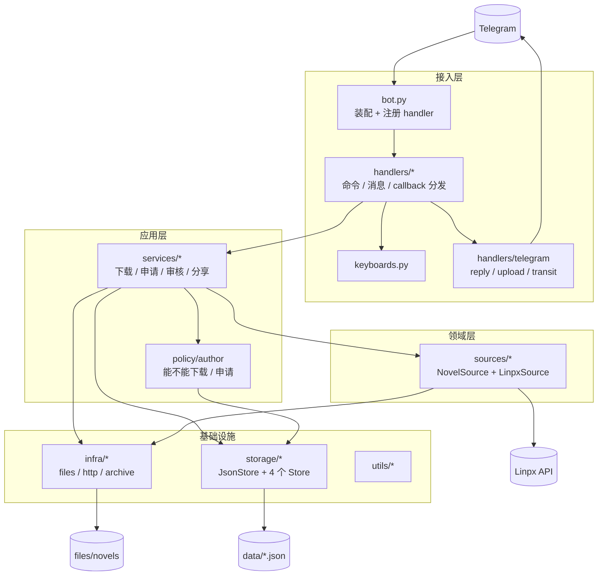

# 03 · 项目架构说明

> 代码基线：`44811fe`（2026-11-11）
> 本文回答「系统由哪些部分构成、边界在哪、哪里不好」。
> **调用链怎么走、改代码改哪一层 → 看 [04](04-如何改代码.md)；功能有没有 → 看 [01](01-功能清单与缺口.md)；时序图 → 看 [05](05-运行时序.md)；往哪走 → 看 [06](06-未来架构.md)。**

---

## 0. 一句话

**单体、事件驱动、分四层的 Telegram Bot**：

```text
handlers（接入） → services（用例编排） → sources（领域模型） → storage / infra（基础设施）
```

一个 Python 进程 + 一组 JSON 文件即可运行。没有数据库、没有任务队列、没有 Web 服务。

---

## 1. 分层与依赖



### 依赖规则（可自查）

| 层 | 可以依赖 | **绝对不可以** |
|---|---|---|
| `handlers/` | telegram、services、policy、storage、sources、keyboards | — |
| `services/` | policy、sources、storage、infra、utils | **telegram** |
| `policy/` | storage（只读名单）、utils | services、telegram |
| `sources/` | infra、utils | services、telegram |
| `storage/` | infra、utils | services、telegram |
| `infra/` `utils/` | 彼此 | 任何上层 |

实测（2026-11-11）：`telegram` 只被 `handlers/` 下 11 个文件 import，其余目录 0 处。自查命令见 **04 第 2.2 节**。

**唯一的已知越界**：`sources/` 会直接写文件、打 zip（`infra/archive.py`、`infra/files.py`），领域层不该落盘。这是待修项，详见第 6 节。

### 设计原则（代码里真实成立的）

| 原则 | 体现 |
|---|---|
| 单一入口 | 所有 Update 从 `bot.py` 进 |
| 回调集中路由 | `callbacks/router.py` 用字典分发 action |
| 用例收口 | 下载 / 申请 / 审核 / 分享都在 `services/` |
| 名单判定收口 | `policy/author.py` 一份规则，下载与申请共用 |
| 管理员判定收口 | `policy/admin.py` 按中转频道权限判定，不维护 ID 名单 |
| 来源适配 | `NovelSource` 抽象 + `_SOURCES` 注册表 |
| 文件即数据库 | JSON + mtime 热加载，零外部依赖 |
| 即传即删 | 上传后 `remove_file` |
| 缓存优先 | `file_id` 缓存 + 分享冷却 |

---

## 2. 目录与职责

| 路径 | 职责 | 关键点 |
|---|---|---|
| `bot.py` | 装配 `Application`，注册 3 命令 + 1 消息 + 1 callback | 只做装配；`post_shutdown` 关闭 HTTP 会话 |
| `config.py` | 从 `.env` 读 8 个变量 | 无启动校验 |
| `keyboards.py` | 生成 `InlineKeyboardMarkup` | 6 个在用，2 个零引用 |
| `handlers/start.py` | `/start` `/help` `/ping` | 用 4 空格缩进（其余文件用 tab） |
| `handlers/download.py` | 私聊/`/down`：解析 → 权限 → 出菜单 | 直接调 `DownloadService` |
| `handlers/review.py` | `/review` 重推待审 | 仅中转频道管理员（`AdminPolicy`） |
| `handlers/callbacks/router.py` | 按 action 分发到 4 个 callback 模块 | 未注册的 action 回「暂不支持」 |
| `handlers/callbacks/{download,apply,review,share}.py` | 各业务在 Telegram 侧的展示逻辑 | 不写业务规则，只调 service |
| `handlers/telegram/reply.py` | 统一回复 | **默认 3 秒后删消息** |
| `handlers/telegram/upload.py` | `send_document` + 写 `file_id` 缓存 | 上传成功后才写缓存 |
| `handlers/telegram/transit.py` | 中转频道卡片 + 审核键盘 | 未配频道返回 `False`（静默） |
| `handlers/telegram/membership.py` | 查中转频道成员状态 | `get_chat_member` + 60 秒缓存；查不到按非管理员 |
| `services/download_service.py` | 检查 / 权限 / 缓存 / 抓取 / 保存 / 上传编排 | 不 import telegram，`upload` 回调注入；权限问 `AuthorPolicy` |
| `services/apply_service.py` | 名单校验 / 重复待审 / 写记录 / 送审 | 不 import telegram，`send_transit` 回调注入；名单校验问 `AuthorPolicy` |
| `policy/author.py` | 黑名单 / 兽人作者名单判定 | 纯判定，只读 `ListManager`；`can_download` / `can_apply` |
| `policy/admin.py` | 管理员判定 | 只看频道成员状态（`creator` / `administrator`）；默认拒绝 |
| `services/review_service.py` | 审核状态 + 名单 + 幂等 + 回滚 | `set_status(expected)` |
| `services/share_service.py` | 冷却 / 并发 / 缓存 / 频道 / 记录 | 目标频道由 `SHARE_MODE` 决定（test / prod） |
| `sources/base.py` | `Novel` / `Series` / `Author` / `NovelSource` | 保留 `.id` `.title` `.url` 别名 |
| `sources/__init__.py` | `_SOURCES` 注册表 + `fetch` / `save` / `resolve_link` | 新增来源只需加一行 |
| `sources/linpx/` | `client` / `parse` / `format` / `urls` / `config` / `errors` | 唯一可用来源 |
| `sources/pixiv/` | 只有 URL 拼接工具 | 未注册、未实现 client |
| `sources/utils.py` | `is_real_series`：判断合并 txt 还是分包 zip | 章节标题数字覆盖率 ≥ 75% |
| `storage/json_store.py` | JSON 存储基类 | 原子写、mtime 热加载、RLock、`prune` 钩子 |
| `storage/author_list.py` | `AuthorListStore` + `ListManager` | 三份名单；`add_blacklist` **不清** `furrylist` |
| `storage/applications.py` | 申请记录与状态流转 | `submit` 累计次数 |
| `storage/file_cache.py` | `file_id` 缓存 | key `kind:id:type`；TTL + prune |
| `storage/share_records.py` | 分享记录与冷却 | key `kind:id` |
| `infra/files.py` `infra/http.py` `infra/archive.py` | 文件 / HTTP / 压缩 | 同步核心 + `asyncio.to_thread` 异步包装；aiohttp 会话按事件循环复用；pyzipper 支持 AES |
| `utils/{json,links,timer,time}.py` | `JsonDict` / 链接与 ID 提取 / 计时器 / 时间 | `JsonDict` 拼错字段静默返回 `None` |
| `data/*.json` | 运行时状态（名单 / 申请 / 缓存 / 分享） | `data/get_authors_data*.py` 是导入推荐作者的一次性脚本 |
| `test/*.py` | 单元测试 | 124 passed；`test_linpx.py` 已过期被排除 |

---

## 3. 数据契约

### 3.1 JSON 结构

所有文件同构：`updated_at` + 一个数据键。

**名单**（`furry_authors.json` / `black_authors.json` / `white_authors.json`，键 `authors`）

```json
{
  "updated_at": "2026-11-11T00:00:00+0000",
  "authors": { "130586197": { "name": "吾寻", "note": "兽人作者申请通过" } }
}
```

| 文件 | 键 | 字段 |
|---|---|---|
| `apply_authors.json` | `applications` | `author_id` `author_name` `link` `user_id` `user_name` `status`(`pending`/`approved`/`rejected`) `created_at` `updated_at` `count` `note` |
| `files_cache.json` | `files` | `file_id` `file_name` `caption` `author_id` `author_name` `uploaded_at` `expires_at` |
| `share_records.json` | `shares` → 作者 id → `{kind}:{item_id}` | 作者层：`author_name`；作品层：`title` `share_count` `first_shared_at` `last_shared_at` `history`；消息层：`message_id` `sent_at` `user_id` `user_name` |

### 3.2 key 规则

| 用途 | 规则 | 示例 |
|---|---|---|
| 下载缓存 | `{kind}:{item_id}:{file_type}` | `novel:18012577:txt` |
| 分享冷却 | `{kind}:{item_id}` | `series:16181401` |
| 分享记录 | `作者 id` → `{kind}:{item_id}` → `频道 id` → 消息数组 | `"130586197" → "novel:123" → "-1001…" → [{message_id, sent_at, user_id, user_name}]` |
| 申请 / 名单 | `author_id` | `130586197` |
| 临时文件 | `files/novels/{author}/{series}/{title}.txt` | `files/novels/吾寻/风举云飞.txt` |

### 3.3 callback_data

格式 `{action};{payload}`，用 `partition(";")` 拆。

| 前缀 | payload |
|---|---|
| `dn` `ds` `dst` `dsz` `dan` | 原始链接 |
| `af` `afy` | 作者或作品链接 |
| `afa` `afr` `afb` | 作者 ID |
| `snp` `sna` `snn` | `kind;item_id;file_type` |

已知风险：

- Telegram 限制 `callback_data` ≤ **64 字节**，超长 URL 可能截断；
- 无签名、无归属校验，理论上可伪造 action 与 payload；
- 不校验操作者是不是当初发起下载的人。

> 完整 action 对照表见 **04 第 3.3 节**。

### 3.4 外部 API

| 用途 | 地址 |
|---|---|
| 展示链接 | `https://linpx.ink/pixiv/novel/{id}` |
| 单篇正文 | `https://api.linpx.ink/pixiv/novel/{id}/cache` |
| 系列与章节 | `https://api.linpx.ink/pixiv/series/{id}/cache` |
| 作者作品列表 | `https://api.linpx.ink/pixiv/user/{id}/cache` |
| 推荐作者（导名单用） | `https://api.linpx.ink/fav/user/cache` |

所有 Linpx 请求都带 `Referer: https://linpx.ink/`。

---

## 4. 架构上的优点

1. **用例已收口到 `services/`**。四条主链路（下载 / 申请 / 审核 / 分享）都能脱离 Telegram 单测，这是 114 个测试能跑起来的前提。
2. **来源适配有扩展点**。`NovelSource` + `_SOURCES` 注册表，加新来源只需实现接口 + 注册一行。
3. **存储轻到极致**。`JsonStore` 统一了原子写、热加载、锁、prune，4 个 Store 各自只写几十行。
4. **`storage/` 是唯一的持久化层**。全仓只有它读写 JSON，`policy` / `services` 只调 `is_blacklisted()` / `get_valid()` / `set_status()` 这类语义方法；默认名单实例收口在 `storage.get_lists()`，四处共用同一份。
5. **缓存策略有效**。`file_id` 复用 + 分享冷却，显著减少重复上传和刷屏。

---

## 5. 架构上的问题

| 级别 | 问题 | 现状 / 影响 |
|---|---|---|
| ~~P0~~ | ~~分享目标写死 `TEST_CHANNEL`~~ | ✅ 已修：目标由 `SHARE_MODE` 决定，文案按实际频道渲染 |
| P0 | 配置无启动校验 | 缺频道只 warning，申请静默丢失 |
| P0 | `callback_data` 可伪造 | 无签名、无归属校验 |
| P1 | 三份名单数据互相清理 | `add_blacklist` 不清 `furrylist`；白名单有存储但产品暂不接入判定 |
| P1 | 跨文件无事务 | `set_status(approved)` 与 `add_furrylist()` 分开，中途失败会出现「状态过了名单没加」 |
| P1 | 逐章串行 + 重复 fetch | 预检 fetch 一次、`save()` 再 fetch 一次，请求翻倍 |
| P1 | 无任务队列、无进度 | 长下载占住 Update 处理链路 |
| P1 | 分享记录无 `message_id` | 作者拉黑后无法自动下架 |
| P1 | `sources/` 直接落盘 | 领域层反向依赖基础设施，测试与替换都变难 |
| P2 | JSON 全量重写 | 每次修改重写整个文件 |
| P2 | 进程内锁 | `RLock` 只管单实例，多实例会互相覆盖 |
| P2 | 文件大小无上限 | 作者全量 zip 可能超 Telegram 限制，无降级 |
| P2 | 无 lint / format / type | tab 与空格混用，重构风险高 |
| P2 | `pytest` 列在运行时依赖 | 生产环境多余 |
| P2 | `__pycache__` 未 ignore；`.gitignore` 对已跟踪文件无效 | 误提交风险 |
| P2 | 无 Dockerfile / 健康检查 / 指标 | 部署与观测不可行 |

### 已经解决的问题（别再当 bug 报）

| 曾经的问题 | 现状 |
|---|---|
| 审核与 `/review` 无权限校验 | ✅ 已修：`policy/admin.py` 按中转频道管理员身份判定，无 ID 名单 |
| 测试失效、`test_list.py` 写真实 `data/` | ✅ 已修：124 passed，统一用 `tmp_path` |
| JSON 写入不是原子操作 | ✅ 已修：临时文件 + `os.replace` |
| HTTP 会话不复用 | ✅ 已修：按事件循环复用，`bot.py` 退出时关闭 |
| 同步 / 异步两套工具重复 | ✅ 已修：单套同步核心 + 异步包装 |
| `README` 只有标题 | ✅ 已修：有快速开始、配置、测试说明 |

---

## 6. 演进建议

### 三阶段

1. **先修 P0**：分享目标、启动校验、伪造回调。
2. **再抽 `policy/`、修正依赖方向**：名单与管理员判定已收口到 `author` / `admin`；`sources/` 不再落盘待做。
3. **最后按数据量决定**是否上 SQLite / 任务队列——现在还为时过早。

### 目标形态

`policy/` 的完整目录树、每条规则的当前落点、实施顺序，都在 **[06 · 未来架构](06-未来架构.md)**。

一句话：**`policy` 回答「能不能」，`storage` 回答「存在哪」，`services` 回答「按什么顺序做」。**

### 迁移步骤

| 步骤 | 动作 | 状态 |
|---|---|---|
| 1 | 修测试、统一 `tmp_path` | ✅ |
| 2 | `policy/admin.py`，保护 `/review` 与审核回调 | ✅（按中转频道管理员身份，无需 `ADMIN_IDS`） |
| 3 | 分享频道改配置列表，记录 `message_id` | ❌ |
| 4 | 抽出 `download_service` | ✅ |
| 4.5 | 抽出 `apply_service` | ✅ |
| 4.6 | 抽出 `review_service`（含幂等 + 回滚） | ✅ |
| 4.7 | 抽出 `share_service` | ✅ |
| 4.8 | 名单默认实例收成 `storage.get_lists()` 单例 | ✅（策略 / 申请 / 下载 / 审核共用，避免互相覆盖） |
| 5 | `Source` 只返回模型，写文件 / 压缩下沉到 storage | ❌ |
| 6 | 名单判定统一到 `author` | ✅（只读黑名单 + 兽人作者名单；白名单产品暂不接入） |
| 7 | 审核单事务 / 幂等 | ⚠️ 部分（已做 `set_status(expected)` + 回滚） |
| 8 | JSON 原子写 ✅；数据量大后迁 SQLite | ⚠️ 部分 |
| 9 | 长任务接入 `JobQueue` 或独立 worker | ❌ |
| 10 | 指标、告警、Dockerfile、部署文档 | ❌ |

### 不建议现在做的事

- **不要上微服务**：当前体量单体 + 清晰分层足够。
- **不要为「自动识别兽人内容」引入大模型**：标签 / 关键词 + 人工审核更可控。
- **不要急着换数据库**：先把 JSON 原子写和备份做扎实。
- **不要在没有测试的情况下大改目录**：先补测试再重构。

---

## 7. 验证

```powershell
# 语法
.venv\Scripts\python.exe -m compileall -q bot.py config.py handlers services policy sources storage infra utils data

# 不启动轮询，只验装配
.venv\Scripts\python.exe -c "import bot; print('import ok')"

# 测试（基线 124 passed）
.venv\Scripts\python.exe -m pytest test -q --ignore=test/test_linpx.py
```

> 「改哪层跑哪个测试」的映射表见 **04 第 5.1 节**。

手工冒烟（需要真实 Token 与频道）：

1. 私聊发一个兽人作者的单篇链接 → 能收到 txt。
2. 点分享 → 目标频道收到文件（`SHARE_MODE=test` 时为 `TEST_CHANNEL`）。
3. 发一个未收录作者的链接 → 出现申请按钮。
4. 在中转频道点通过 → 作者进 `furry_authors.json`，申请人收到私聊。
5. 执行 `/review` → 无待审时返回「当前没有待审核申请」。

