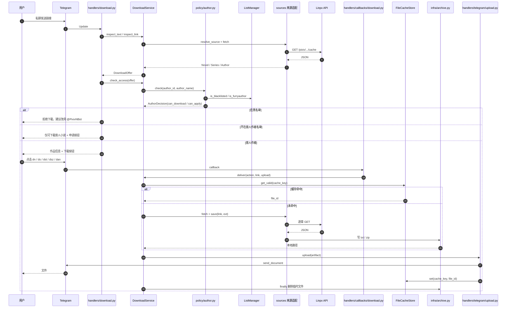
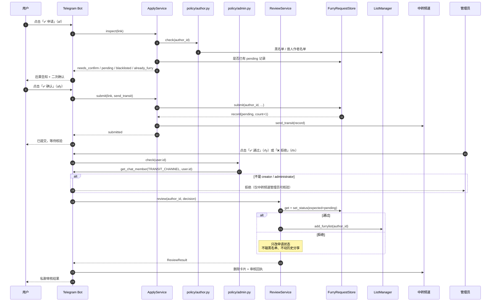
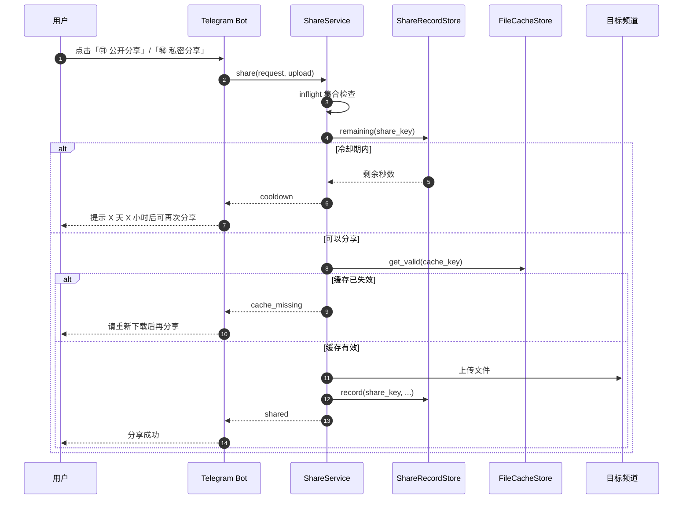
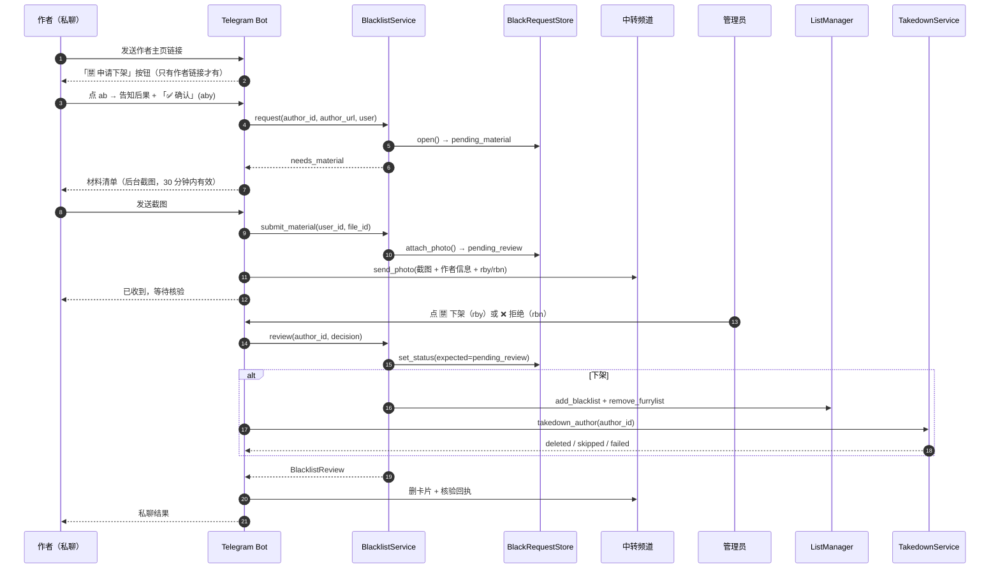

# 05 · 运行时序

> 代码基线：2026-11-13（历史改写后提交号会变，故只记日期）
> 本文只画**四条主链路的异步顺序**：下载、申请 / 审核、分享、作者本人申请下架。
> 结构看 [03](03-项目架构说明.md)，改哪层看 [04](04-如何改代码.md)，往哪走看 [06](06-未来架构.md)。

> **关于图中名字**：`participant` 左边的 `downloadService` 这类小驼峰 id 只是 mermaid 图内引用名，**不参与显示**；方框和箭头上显示的是 `as` 后面的完整名称。

---

## 1. 下载

读图要点：

- **预检和保存各 fetch 一次**。`inspect_link` 为拿标题 / 作者抓一次，`save()` 生成文件时再抓一次——同一作品请求数翻倍（P1）。
- **缓存优先于抓取**。`prepare` 先查 `FileCacheStore`，命中就直接拿 `file_id`，连本地文件都不生成。
- **上传成功后才写缓存**。`upload_file` 在 `send_document` 成功后才 `set`，避免缓存一个不存在的 `file_id`。
- **`finally` 兜底删文件**。即使上传抛异常，`deliver` 也会删掉本地临时文件。
- **同一链接串行**。`prepare` / `deliver` 外层套了按链接的 `asyncio.Lock`（`services/download_service.py` 的 `_exclusive`）：两个并发 dst 会写同一个 `files/novels/<标题>.txt`，`write_text` 先截断再写，串起来就是「章节重复 / 顺序错乱 / 尾巴缺失」；加锁后第二个请求等第一个传完，直接命中它写下的 `file_id`。`deliver` 的锁包住上传，避免「边传边被重写」。不同链接仍然并行。
- **系列首章按钮（`dsf`）已整体移除**。`down_series_keyboard()` 不再产出「📄 下载首章」，`router.HANDLERS` 与 `DownloadService._ACTIONS` 均无引用，`test_keyboard_routing.py` 4 passed。

---

## 2. 申请 / 审核

读图要点：

- **审核权限看频道身份**。`policy/admin.py` 只认 `TRANSIT_CHANNEL` 的 `creator` / `administrator`；成员状态缓存 60 秒，撤销管理员后最多 1 分钟生效，代码与 `.env` 都不需要维护 ID。
- **`set_status(expected=pending)` 提供幂等**。两个管理员同时点「通过」，只有一个能改状态成功，另一个拿到失败结果，避免重复加名单。
- **跨文件没有真正的原子事务**。`set_status` 与 `add_furrylist` 仍是两次独立写盘；不过名单写失败时 `ReviewService._rollback` 会把状态退回 `pending`，不会长期停在「状态已通过、名单没加上」，只是窗口内可能不一致。
- **送中转失败不影响申请记录**。`send_transit` 在 `submit` 之后调用且异常被捕获——所以会出现「有 pending 记录但频道没卡片」，靠 `/review` 补发。
- **核验不裁决作者**。`rfy` / `rfn` 只决定「这位用户替作者提的申请是否成立」；拉黑必须由作者本人的诉求触发，所以没有 `afb`。下架历史分享挂在「作者下架申请」的核验入口（`rby`）上。

---

## 3. 分享

读图要点：

- **`inflight` 只在内存**。进程重启即丢失，重启窗口内同一作品可能被重复分享（P1）。
- **`remaining` 是 check-then-act**。查冷却和写记录之间没有锁，并发点击靠 `inflight` 兜；审核那边已用 `expected` 改成原子操作，分享还没有。
- **目标频道由 `SHARE_MODE` 决定**。`test` 只发测试频道；`prod` 时高分（`score >= SHARE_SCORE_THRESHOLD`）发兽人阅读 + 兽人小说，低分 / 未评分只发兽人小说。私聊文案按 `ShareResult.channels` 渲染，不再写死。**但 handler 目前从不传 `score`**（`ShareRequest.score` 恒为 `None`），所以 `prod` 实际只发 `FURRY_NOVELS`；评分是未实现的能力。
- **记录以作者归档、带 `message_id`**。`share_records.json` 是 作者 → 作品 → 频道 → 消息数组；`by_author()` 能拿到全部 `(chat_id, message_id)` 逐条删除，再 `drop_author()`。这条下架链路已接线：作者下架申请核验通过（`rby`）后，handler 调 `takedown_author` 删除频道消息，删除失败的记录保留以便重试。

---

## 4. 作者本人申请下架

读图要点：

- **「申请下架」不止作者链接有**。未收录作者时的 `apply_author_keyboard(author_url)` 与兽人作者的 `down_author_keyboard(author_url, is_furry=True)` 都带这个按钮；单篇 / 系列链接走到 `needs_apply` 分支时也会看到申请键盘。`/black` 另外接受作者 ID，由 `handlers/author.py · _author_link()` 归一化成标准主页链接。
- **截图靠「等截图」状态绑定**，不靠回复关系：一个用户同时只有最近一条 `pending_material` 有效，30 分钟过期后要重新点申请。
- **普通图片静默忽略**：没有待提交申请时不回任何消息，避免把私聊图片当材料。
- **核验通过 = 进黑名单 + 下架历史分享**。名单由 `add_blacklist` + `remove_furrylist` 写入；频道消息由 handler 在通过后调 `takedown_author` 删除，删除失败只记日志、不回滚名单（失败的记录保留，便于重试）。名单写失败会把申请回滚成 `pending_review`，可以重试。
