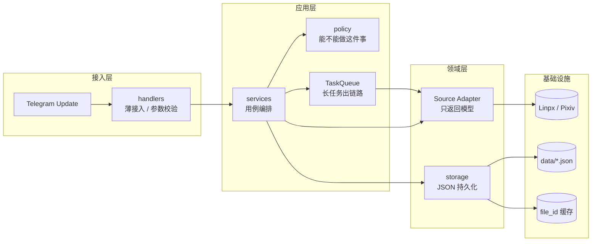

# 06 · 未来架构

> 代码基线：2026-11-12（`storage.get_lists()` 名单单例落地）
> 本文写**目标形态**，不是现状。现状看 [03](03-项目架构说明.md)，缺什么看 [01](01-功能清单与缺口.md)。
> 每条都带「现状」——**没实施的一律写 ❌，不要当成已完成**。

---

## 0. 一句话

现在：`handlers → services → sources → storage / infra` 四层已经跑顺，`services/` 把四类业务收口了（共 913 行），名单与管理员判定已抽到 `policy/`，名单默认实例已收成进程内唯一（`storage.get_lists()`）。

目标：补齐 `policy/`，把长任务移出 Update 链路，再补审计字段。

| 加什么 | 回答什么问题 |
|---|---|
| `policy/`（往里） | 「**能不能**」——权限、名单优先级、冷却、内容判定 |
| `TaskQueue` | 「**什么时候做**」——长任务从 Update 链路里移出去 |
| 审计字段 | 「**做过什么**」——`message_id` 支持拉黑后下架 |

---

## 1. 目标分层



### 与现状逐层对照

| 层 | 现在有什么 | 目标要加 | 状态 |
|---|---|---|---|
| `handlers/` | 6 个模块 + `callbacks/` 5 个文件（541 行） | 不再加层，保持「只展示」 | ✅ |
| `services/` | 4 个 service（913 行） | 内部改为调用 `policy`；存储实例由构造参数注入 | ⚠️ 下载 / 申请已调 `author`，审核已调 `admin`；默认名单已收成单例 |
| `policy/` | `author`（名单）+ `admin`（频道管理员） | content | ⚠️ 部分 |
| `sources/` | `linpx` 自己写文件、自己打 zip | 只返回模型，不碰文件系统 | ❌ |
| `storage/` `infra/` | `JsonStore` + 4 个 Store + `get_lists()` / `get_default_cache()` | 唯一的持久化层：只有它读写 JSON，上层只调语义方法 | ✅ |
| 任务队列 | 无，下载在 Update 链路里同步跑 | `JobQueue` 或独立 worker | ❌ |

---

## 2. 五条核心变化

| # | 变化 | 解决什么 | 现状与证据 |
|---|---|---|---|
| 1 | `handlers/` 只做「解析参数 → 调 service → 展示结果」 | 业务规则散在 callback 里，改一处要看三个文件 | ✅ `callbacks/` 541 行基本只有展示逻辑 |
| 2 | 新增 `policy/` | 同一条规则多处实现，迟早不一致 | ⚠️ `author` / `admin` 已收口；`content` 未建 |
| 3 | `Source` 不落盘 | 领域层反向依赖基础设施，无法脱离文件系统测试 | ❌ `sources/linpx/__init__.py` 直接 import `zip_path`、`save_text` |
| 4 | 长任务进 `TaskQueue` | 作者全量下载占住 Update 链路，别人只能排队 | ❌ 未配 `concurrent_updates`；`JobQueue` 需装 `python-telegram-bot[job-queue]`，当前 `apscheduler` **未安装** |
| 5 | 分享记录加 `message_id` / `chat_id` / `author_id` | 下架要能定位到「哪个频道哪条消息」 | ⚠️ 记录已按作者归档并带 `message_id`；拉黑后自动下架的流程尚未接入 |

> 第 1 条是这一轮重构的成果；2~5 是下一步。

---

## 3. 建议的目录调整

```text
services/                      # ✅ 已存在，913 行
├── download_service.py        # 323 行：缓存 → fetch → save → upload
├── apply_service.py           # 215 行：申请校验、写入、送审
├── review_service.py          # 175 行：审核事务：状态 + 名单 + 通知
└── share_service.py           # 200 行：冷却、缓存、频道发送、记录

policy/                        # ⚠️ 部分：纯判定，最好测
├── author.py                  # ✅ 黑名单 > 兽人作者名单；都不在 → 禁止下载、可申请
├── admin.py                   # ✅ 中转频道管理员（creator / administrator），无 ID 名单
└── content.py                 # ❌ 标签 / 正文关键词（可选，先别急着做）

storage/                       # ✅ 唯一的持久化层：只有这里读写 JSON
├── __init__.py                # 导出 ListManager / get_lists
├── json_store.py              # 原子写 / mtime 热加载 / 锁 / prune
├── author_list.py             # 三份名单 + get_lists() 进程内单例
├── applications.py
├── file_cache.py              # + get_default_cache()
└── share_records.py
```

### 3.1 现在这些逻辑实际散在哪

| 规则 / 职责 | 现在的落点 | 目标落点 |
|---|---|---|
| 黑名单 / 兽人名单判定 | ✅ 已统一到 `policy/author.py`，`download_service.check_access()` 与 `apply_service._blocked()` 都调它 | `author`（白名单暂不接入） |
| 管理员判定 | ✅ 已统一到 `policy/admin.py`：按中转频道 `creator` / `administrator` 判定，无 ID 名单 | `admin` |
| 分享冷却 | `share_service` + `share_records.remaining()` | 留在 `share_service`（它需要 Store 的返回值） |
| 名单 / 记录读写 | service 直接调 `ListManager` / `Store` 的语义方法 | 留在 `storage`：默认实例走 `get_lists()` / `get_default_cache()` |
| 文件落盘 / 压缩 | `sources/linpx/__init__.py` 直接调 `infra.archive` / `infra.files` | 由 service 调 `infra`，`sources` 不再碰 |

### 3.2 为什么只抽 policy

| 目录 | 唯一职责 | 不抽会怎样 |
|---|---|---|
| `policy/` | 「**能不能**」 | 同一条规则两处实现，迟早不一致——`whitelist` 至今没进判定，就是这么变成死数据的 |

一句话：**`policy` 回答能不能，`storage` 回答存在哪，`services` 回答按什么顺序做。**

`storage/` 保持现状：全仓只有它读写 JSON（`json.dumps` 只出现在 `storage/json_store.py:65`），`policy` / `services` 只调 `is_blacklisted()` / `get_valid()` / `set_status()` 这类语义方法，默认实例由 `get_lists()` / `get_default_cache()` 提供；换存储只改 `storage/` 下的类。

**不需要新建的**：`handlers/` 除了现有的 `callbacks/` 与 `telegram/` 不再拆；`infra/` 保持现状——它已经只是「文件 / HTTP / 压缩」三件事。

---

## 4. 实施顺序

完整迁移表在 [03 第 6 节](03-项目架构说明.md)，这里只给与本文相关的顺序和前置条件。

| 顺序 | 做什么 | 前置条件 | 为什么排这里 |
|---|---|---|---|
| 1 | `policy/admin.py` 管理员判定 | ✅ 已完成：按中转频道成员身份，不需要 `ADMIN_IDS` | 纯新增、零依赖；顺手堵住「谁都能审核」的窟窿 |
| 2 | `Source` 不落盘，写文件下沉 | 无 | 改动只落在 `sources/`，不牵连 `services/`；`save_*` 签名保留，独立调用不受影响 |
| 3 | `author` 收口名单判定 | ✅ 已完成：只读黑名单 + 兽人作者名单；白名单按产品决定暂不接入 | 产品语义已定：黑名单拒下载禁申请，兽人名单允许下载，其余禁止下载可申请 |
| 4 | 名单默认实例收成 `storage.get_lists()` 单例 | ✅ 已完成：策略 / 申请 / 下载 / 审核共用同一实例 | 4 处 `ListManager()` 各自持快照会互相覆盖；单例是修缺陷，不是加抽象 |
| 5 | `TaskQueue` | 有真实并发压力 | 当前流量不值这个复杂度 |

判断依据：**改接口次数最少的排前面**。

---

## 5. 边界：不做什么

见 [03 第 6 节](03-项目架构说明.md) 的「不建议现在做的事」。一句话：不上微服务、不上大模型做内容识别、不急着换数据库、不在没测试时大改目录。

