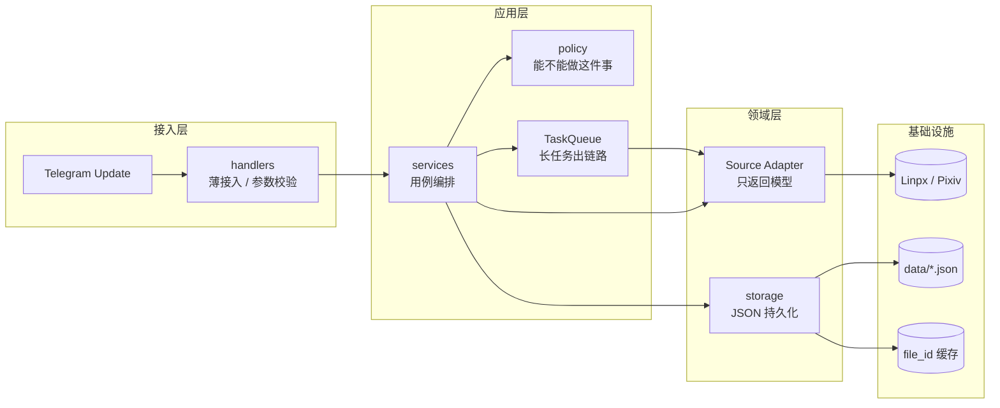

# 06 · 未来架构

> 代码基线：2026-11-23（`storage.get_lists()` 名单单例 + 下架链路已落地；历史改写后提交号会变，故只记日期）
> 本文写**目标形态**，不是现状。现状看 [03](03-项目架构说明.md)，缺什么看 [01](01-功能清单与缺口.md)。
> 每条都带「现状」——**没实施的一律写 ❌，不要当成已完成**。

---

## 0. 一句话

现在：`handlers → services → sources → storage / infra` 四层已经跑顺，`services/` 把六类业务收口了（下载 / 申请 / 审核 / 分享 / 下架申请 / 历史下架），另有 `packaging.py`（落盘 / 压缩）、`sync_service.py`（运营数据同步）、`import_author_service.py`（抓 Linpx 推荐作者并入名单）与 `tag_service.py`（标签留档装配），共 10 个业务模块；名单与管理员判定已抽到 `policy/`，名单默认实例已收成进程内唯一（`storage.get_lists()`）。

目标：补齐 `policy/`，把长任务移出 Update 链路，再补审计字段。

| 加什么 | 回答什么问题 |
|---|---|
| `policy/`（往里） | 「**能不能**」——权限、名单优先级、冷却、内容判定 |
| `TaskQueue` | 「**什么时候做**」——长任务从 Update 链路里移出去 |
| 审计字段 | 「**做过什么**」——`message_id` 支持拉黑后下架 |

---

## 1. 目标分层



### 与现状逐层对照

| 层 | 现状 | 状态 |
|---|---|---|
| `handlers/` | 6 个顶层模块 + `callbacks/` + `telegram/` | ✅ 只展示 |
| `services/` | 10 个业务模块 | ✅ 已调 `policy` |
| `policy/` | `author` + `admin` + `scoring` | ⚠️ 缺 `content` |
| `sources/` | 只返回模型 | ✅ |
| `storage/` `infra/` | `JsonStore` + 7 个 Store + `get_*()` 单例 | ✅ |
| 任务队列 | 无，下载在 Update 链路里同步跑 | ❌ |

---

## 2. 还没做的两件事

| 变化 | 现状 |
|---|---|
| `policy/content.py` | ❌ 正文关键词 / 自动判定未建；标签分流已覆盖 |
| 长任务进 `TaskQueue` | ❌ 仍占 Update 槽；`apscheduler` 未安装 |

---

## 3. 建议的目录调整

```text
services/                      # ✅ 已存在，10 个业务模块 + __init__
├── download_service.py        # 缓存 → fetch → save → upload
├── apply_service.py           # 申请校验、写入、送审
├── review_service.py          # 审核事务：状态 + 名单 + 通知
├── share_service.py           # 冷却、缓存、频道发送、记录
├── blacklist_service.py       # 受理 → 材料 → 核验 → 名单
├── takedown_service.py        # 按作者删历史分享
├── packaging.py               # 落盘 / 命名 / 压缩（来源只返回模型）
├── import_author_service.py   # 抓 Linpx 推荐作者并入名单（仅 /sync 调用；抓取走 sources）
├── tag_service.py             # 装配未识别标签留档 + 运营读写（sources 只留回调位）
└── sync_service.py            # 执行 script/sync_data.sh（Windows 为 .ps1）、超时与输出收集

policy/                        # ⚠️ 部分：纯判定，最好测
├── author.py                  # ✅ 黑名单 > 兽人作者名单；都不在 → 禁止下载、可申请
├── admin.py                   # ✅ 中转频道管理员（creator / administrator），无 ID 名单
└── content.py                 # ❌ 正文关键词（标签已由 sources/tags.py 的受控词表覆盖，见 08；这里只做正文）

storage/                       # ✅ 唯一的业务持久化层：只有这里读写 data/*.json
├── __init__.py                # 导出 ListManager / 各 Store / get_*() 单例
├── json_store.py              # 原子写 / mtime 热加载 / 锁 / prune
├── author_list.py             # 名单 + get_lists() 进程内单例
├── furry_request.py           # 兽人作者申请 + get_furry_requests()
├── black_request.py           # 作者下架申请 + get_black_requests()
├── file_cache.py              # file_id 缓存 + get_file_cache()
├── fetch_cache.py             # JSON 响应请求缓存（key = 请求 URL）+ get_fetch_cache()
├── share_records.py           # 分享记录 / 冷却 / 消息保留（TTL 来自 config）
└── unknown_tags.py            # 未识别标签表 + get_unknown_tags()（不自动淘汰）
```

### 3.1 现在这些逻辑实际散在哪

| 规则 / 职责 | 落点 |
|---|---|
| 黑名单 / 兽人名单判定 | `policy/author.py` |
| 管理员判定 | `policy/admin.py` |
| 分享冷却 | `share_service` + 分享记录 Store |
| 名单 / 记录读写 | 各 Store 的语义方法（`get_*()` 单例） |
| 文件落盘 / 压缩 | `services/packaging.py` |

### 3.2 为什么只抽 policy

| 目录 | 唯一职责 | 不抽会怎样 |
|---|---|---|
| `policy/` | 「**能不能**」 | 同一条规则两处实现，迟早不一致 |

一句话：**`policy` 回答能不能，`storage` 回答存在哪，`services` 回答按什么顺序做。**

`storage/` 保持现状：**业务 JSON 只有它读写**（`storage/json_store.py · _write_payload()` 是 `data/*.json` 的唯一写入点），`policy` / `services` 只调 `is_blacklisted()` / `get_valid()` / `set_status()` 这类语义方法，默认实例由 `get_lists()` / `get_file_cache()` / `get_fetch_cache()` / `get_furry_requests()` / `get_black_requests()` / `get_share_records()` 提供；换存储只改 `storage/` 下的类。
（例外：`infra/files.py` 的 `read_json_sync()` / `save_json_sync()` 也调 `json`，但只服务测试的临时文件与异步包装，不碰 `data/`。）

**不需要新建的**：`handlers/` 除了现有的 `callbacks/` 与 `telegram/` 不再拆；`infra/` 保持现状——它已经只是「文件 / HTTP / 压缩」三件事。

---

## 4. 实施顺序

完整迁移表在 [03 第 6 节](03-项目架构说明.md)，这里只给与本文相关的顺序和前置条件。

| 顺序 | 做什么 | 前置条件 |
|---|---|---|
| 1 | `TaskQueue`：长任务移出 Update 链路 | 有真实并发压力 |

判断依据：**改接口次数最少的排前面**。

---

## 5. 边界：不做什么

见 [03 第 6 节](03-项目架构说明.md) 的「不建议现在做的事」。一句话：不上微服务、不上大模型做内容识别、不在没测试时大改目录。

