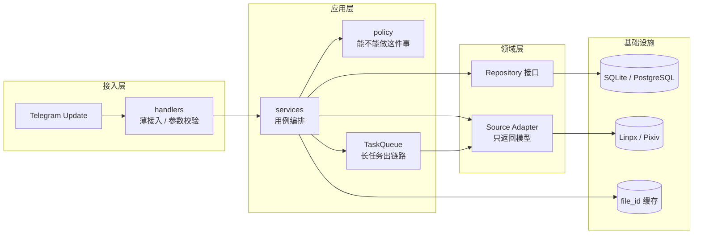

# 06 · 未来架构

> 代码基线：`44811fe`（2026-11-11）
> 本文写**目标形态**，不是现状。现状看 [03](03-项目架构说明.md)，缺什么看 [01](01-功能清单与缺口.md)。
> 每条都带「现状」——**没实施的一律写 ❌，不要当成已完成**。

---

## 0. 一句话

现在：`handlers → services → sources → storage / infra` 四层已经跑顺，`services/` 把四类业务收口了（共 913 行），名单判定已抽到 `policy/author.py`。

目标：补齐 `policy/`，在 `services/` 下方加一层的 `repositories/`，再补两件工程能力。

| 加什么 | 回答什么问题 |
|---|---|
| `policy/`（往里） | 「**能不能**」——权限、名单优先级、冷却、内容判定 |
| `repositories/`（往下） | 「**存在哪**」——JSON / SQLite / 内存 |
| `TaskQueue` | 「**什么时候做**」——长任务从 Update 链路里移出去 |
| 审计字段 | 「**做过什么**」——`message_id` 支持拉黑后下架 |

---

## 1. 目标分层



### 与现状逐层对照

| 层 | 现在有什么 | 目标要加 | 状态 |
|---|---|---|---|
| `handlers/` | 6 个模块 + `callbacks/` 5 个文件（541 行） | 不再加层，保持「只展示」 | ✅ |
| `services/` | 4 个 service（913 行） | 内部改为调用 policy / repository | ⚠️ 下载 / 申请已调 `author`；repository 未建 |
| `policy/` | 只有 `author`（黑名单 + 兽人作者名单） | admin / content | ⚠️ 部分 |
| `repositories/` | **不存在** | 4 个仓储接口 | ❌ |
| `sources/` | `linpx` 自己写文件、自己打 zip | 只返回模型，不碰文件系统 | ❌ |
| `storage/` `infra/` | `JsonStore` + 4 仓储，工具齐全 | 被 `repositories` 包一层 | ⚠️ 可复用，需加接口 |
| 任务队列 | 无，下载在 Update 链路里同步跑 | `JobQueue` 或独立 worker | ❌ |

---

## 2. 六条核心变化

| # | 变化 | 解决什么 | 现状与证据 |
|---|---|---|---|
| 1 | `handlers/` 只做「解析参数 → 调 service → 展示结果」 | 业务规则散在 callback 里，改一处要看三个文件 | ✅ `callbacks/` 541 行基本只有展示逻辑 |
| 2 | 新增 `policy/` | 同一条规则多处实现，迟早不一致 | ⚠️ `author` 已收口下载 / 申请两处判定；`admin` / `content` 未建 |
| 3 | 新增 `repositories/` | 业务层直接依赖具体 `JsonStore` 子类 | ❌ 4 个 service 全部 `import storage.*` |
| 4 | `Source` 不落盘 | 领域层反向依赖基础设施，无法脱离文件系统测试 | ❌ `sources/linpx/__init__.py` 直接 import `zip_path`、`save_text` |
| 5 | 长任务进 `TaskQueue` | 作者全量下载占住 Update 链路，别人只能排队 | ❌ 未配 `concurrent_updates`；`JobQueue` 需装 `python-telegram-bot[job-queue]`，当前 `apscheduler` **未安装** |
| 6 | 分享记录加 `message_id` / `chat_id` / `author_id` | 没有 `message_id` 就无法「拉黑后自动下架」 | ❌ `share_records` 只有 `last_chat_ids` |

> 第 1 条是这一轮重构的成果；2~6 是下一步。

---

## 3. 建议的目录调整

```text
services/                      # ✅ 已存在，913 行
├── download_service.py        # 323 行：缓存 → fetch → save → upload
├── apply_service.py           # 215 行：申请校验、写入、送审
├── review_service.py          # 175 行：审核事务：状态 + 名单 + 通知
└── share_service.py           # 200 行：冷却、缓存、频道发送、记录

policy/                        # ⚠️ 部分：纯判定，最好测
├── author.py           # ✅ 黑名单 > 兽人作者名单；都不在 → 禁止下载、可申请
├── admin_policy.py            # ❌ ADMIN_IDS + 频道管理员
└── content_policy.py          # ❌ 标签 / 正文关键词（可选，先别急着做）

repositories/                  # ❌ 待建：隔离存储
├── author_repository.py
├── application_repository.py
├── file_cache_repository.py
└── share_repository.py
```

### 3.1 现在这些逻辑实际散在哪

| 规则 / 职责 | 现在的落点 | 目标落点 |
|---|---|---|
| 黑名单 / 兽人名单判定 | ✅ 已统一到 `policy/author.py`，`download_service.check_access()` 与 `apply_service._blocked()` 都调它 | `author`（白名单暂不接入） |
| 管理员判定 | **不存在**（任何人都能审核） | `admin_policy` |
| 分享冷却 | `share_service` + `share_records.remaining()` | 留在 `share_service`（它需要 Store 的返回值） |
| 名单 / 记录读写 | 4 个 service 直接调 `ListManager` / `Store` | `repositories` |
| 文件落盘 / 压缩 | `sources/linpx/__init__.py` 直接调 `infra.archive` / `infra.files` | 由 service 调 `infra`，`sources` 不再碰 |

### 3.2 为什么是这两个目录

| 目录 | 唯一职责 | 不抽会怎样 |
|---|---|---|
| `policy/` | 「**能不能**」 | 同一条规则两处实现，迟早不一致——`whitelist` 至今没进判定，就是这么变成死数据的 |
| `repositories/` | 「**存在哪**」 | 换存储要改 4 个 service；测试只能写临时文件 |

一句话：**`policy` 回答能不能，`repositories` 回答存在哪，`services` 回答按什么顺序做。**

**不需要新建的**：`handlers/` 除了现有的 `callbacks/` 与 `telegram/` 不再拆；`infra/` 保持现状——它已经只是「文件 / HTTP / 压缩」三件事。

---

## 4. 实施顺序

完整迁移表在 [03 第 6 节](03-项目架构说明.md)，这里只给与本文相关的顺序和前置条件。

| 顺序 | 做什么 | 前置条件 | 为什么排这里 |
|---|---|---|---|
| 1 | `admin_policy` + `ADMIN_IDS` | 无 | 纯新增、零依赖；顺手堵住「谁都能审核」的窟窿 |
| 2 | `Source` 不落盘，写文件下沉 | 无 | 必须早于 `repositories`，否则要改两遍 |
| 3 | `author` 收口名单判定 | ✅ 已完成：只读黑名单 + 兽人作者名单；白名单按产品决定暂不接入 | 产品语义已定：黑名单拒下载禁申请，兽人名单允许下载，其余禁止下载可申请 |
| 4 | `repositories` | 等 `policy` 与 `Source` 稳定 | 它会动所有 service 的构造函数 |
| 5 | `TaskQueue` | 有真实并发压力 | 当前流量不值这个复杂度 |

判断依据：**改接口次数最少的排前面**。

---

## 5. 边界：不做什么

见 [03 第 6 节](03-项目架构说明.md) 的「不建议现在做的事」。一句话：不上微服务、不上大模型做内容识别、不急着换数据库、不在没测试时大改目录。

